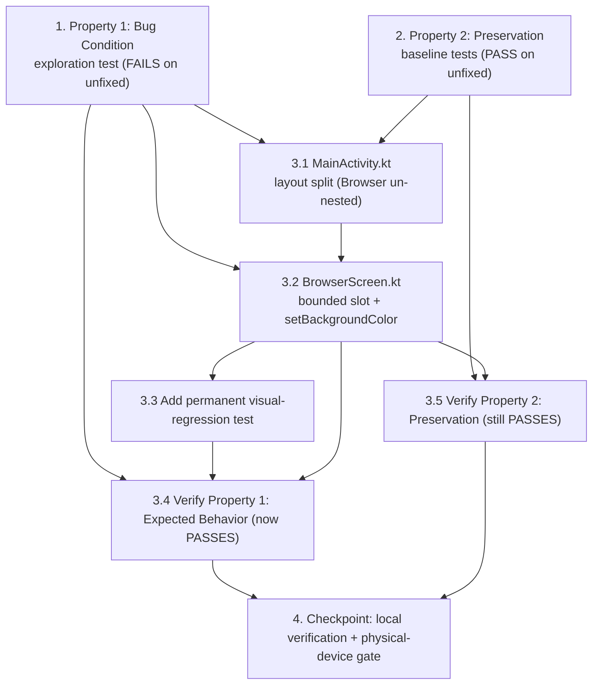

> Release 1.0.2 takeover note (15 November 2026): the original exploratory plan below is retained for traceability. Its pre-fix failure claims, completion checkboxes and proposed helper contracts are not release evidence. Codex replaced copied/reflection-only tests with production-seam regressions, corrected lifecycle durability claims, and resolved the EGM findings. See docs/AGENT_HANDOFF.md and docs/reviews/release-1.0.2-*.md. Exact-source CI, native and signed-APK results are recorded separately; physical/OEM/accessibility checks remain open.

# Implementation Plan

## Overview

This plan fixes the Browser screen's black, non-painting WebView using the bug-condition
methodology from `design.md`. The change is surgical: a layout split in `MainActivity.kt`,
a bounded slot plus one `setBackgroundColor` in `BrowserScreen.kt`, and one new instrumented
visual-regression test. All WebClient / WebChromeClient / settings logic is left untouched, so
the fix never reintroduces cleartext HTTP, trust-all TLS, or a JavaScript bridge.

Tests are written BEFORE the fix: the Property 1 exploration test must FAIL on the unfixed
hosting (proving the defect), and the Property 2 preservation tests must PASS on the unfixed
code (capturing the baseline to preserve).

## Task Dependency Graph

Waves group tasks that can proceed together; each wave depends on the waves before it.

```json
{
  "waves": [
    { "wave": 1, "tasks": ["1", "2"], "note": "Written in parallel; both run against UNFIXED code. Task 1 must FAIL, Task 2 must PASS." },
    { "wave": 2, "tasks": ["3.1"], "note": "Un-nest the Browser branch from the outer verticalScroll." },
    { "wave": 3, "tasks": ["3.2"], "note": "WebView owns a bounded, non-scrolling slot + explicit background (needs 3.1)." },
    { "wave": 4, "tasks": ["3.3"], "note": "Permanent visual-regression test matching the fixed hosting (needs 3.2)." },
    { "wave": 5, "tasks": ["3.4", "3.5"], "note": "Re-run Task 1 (now PASSES) and Task 2 (still PASSES)." },
    { "wave": 6, "tasks": ["4"], "note": "Local verification + physical-device gate." }
  ]
}
```



**Dependency notes:**

- Tasks 1 and 2 have no code dependencies and may be written in parallel; both must run against the UNFIXED code first.
- Task 1 must be observed FAILING and Task 2 observed PASSING before any edit in Task 3 begins.
- 3.1 (un-nest the Browser branch) precedes 3.2 (the WebView can only own a bounded, non-scrolling slot once its parent no longer applies `verticalScroll`).
- 3.3 reuses the harness shape proven in Task 1 and depends on 3.2 being in place.
- 3.4 re-runs the Task 1 test (no new test) and depends on the full fix (3.1 + 3.2) and the permanent test (3.3).
- 3.5 re-runs the Task 2 tests (no new tests) and depends on the fix (3.1 + 3.2).
- Task 4 gates on 3.4 and 3.5; its physical-device sub-gate cannot be closed by the emulator alone.

## Tasks

- [ ] 1. Write bug condition exploration test (BEFORE implementing the fix)
  - **Property 1: Bug Condition** - Hosted Browser WebView Paints the Loaded Page
  - **CRITICAL**: This test MUST FAIL on unfixed code - failure confirms the black, non-painting surface exists
  - **DO NOT attempt to fix the test or the code when it fails** in this task
  - **NOTE**: This test encodes the expected behavior; it will validate the fix when it passes after implementation (reused in task 3.4)
  - **GOAL**: Surface a counterexample that demonstrates the black surface under the current nested-scroll hosting
  - **Scoped PBT Approach**: The defect is deterministic for the hosting configuration, so scope the property to the concrete failing case from `isBugCondition`: `providerSupportsMultiProfile = true`, `inScopePageLoaded = true`, `rendererAlive = true`, `hostedInsideParentVerticalScroll = true`, `webViewHasExplicitBackground = false`
  - Add an instrumented test under `app/src/androidTest/java/dev/esuite/app/` that reproduces the current hosting: place a `WebView` inside a `verticalScroll`-backed parent with NO `setBackgroundColor`, attach it to a real window, load an in-scope `https://` page that paints a distinct non-background color, and sample pixels in the WebView region
  - Capture pixels from the attached view/window (draw the view into a `Bitmap`, or use `PixelCopy` / `UiAutomation` against the hosting window) rather than reading the raw surface, so the check is stable under the software-rendered API 37 emulator
  - Assert the sampled region is NOT uniformly the window background color `Midnight (0xFF071019)`
  - Gate on `MULTI_PROFILE` with `assumeTrue` exactly as `DeviceBoundaryTest` does, so the test skips (not fails) where the capability is absent
  - Run on UNFIXED code
  - **EXPECTED OUTCOME**: Test FAILS - the region reads as uniformly the near-black window color despite a loaded, JS-alive page (this is correct and proves the bug)
  - Document the counterexample (e.g. "WebView region sampled uniformly `0xFF071019` / Midnight although the page is loaded and JS-responsive")
  - Mark this task complete when the test is written, run, and its failure is documented
  - _Requirements: 1.1, 1.2, 1.3, 2.1, 2.3, 2.5_

- [ ] 2. Write preservation property tests (BEFORE implementing the fix)
  - **Property 2: Preservation** - Non-Visual Browser Behavior Unchanged
  - **IMPORTANT**: Follow the observation-first methodology - observe behavior on UNFIXED code, then encode it
  - **GOAL**: Capture the exact baseline for every input where `isBugCondition` returns false, so the layout/background fix provably changes nothing else
  - Add a JVM property-based test (`app/src/test/java/dev/esuite/app/core/`, alongside `ScopeAnalysisTest.kt`) that generates URLs across schemes, hosts, ports, paths, and fragments and asserts `ScopePolicy.allows` / `requireAllowed` give the SAME verdict as the current implementation for in-origin vs out-of-origin inputs (scope-enforcement invariant)
  - In the same PBT family, generate `(project.id, identity)` pairs and assert the derived per-identity profile key `esuite_{project.id}_{identity}` is unchanged (profile-isolation key derivation)
  - Observe and record, on UNFIXED code, the instrumented preservation behaviors and assert them so they still hold after the fix:
    - TLS/certificate error → `onReceivedSslError` calls `handler.cancel()` and the error is never ignored
    - `MULTI_PROFILE` unsupported → the unsupported-provider message shows and no `WebView` is created
    - Inspector tools (element select, local HTML/CSS edit, native cookie read, storage read, console evaluate) return the same shapes (reuse `DeviceBoundaryTest` inspector/cookie assertions)
    - `onRenderProcessGone` nulls the `WebView` and surfaces the "Restart browser renderer" action
    - Per-identity profile isolation: a cookie set under identity A is not visible to identity B's profile
    - Non-Browser screens still render under the existing `darkColorScheme` within the outer `verticalScroll(pageScroll)`
  - Run on UNFIXED code
  - **EXPECTED OUTCOME**: Tests PASS (this confirms the baseline behavior that must be preserved)
  - Mark this task complete when the tests are written, run, and passing on unfixed code
  - _Requirements: 3.1, 3.2, 3.3, 3.4, 3.5, 3.6, 3.7, 3.8, 3.9, 3.10_

- [ ] 3. Fix the Browser black, non-painting WebView surface

  - [ ] 3.1 Split the layout in `MainActivity.kt` so the Browser branch is not nested in the outer scroll
    - In `ESuiteApp`, stop hosting the `Screen.Browser` branch inside `Column(... .verticalScroll(pageScroll) ...)`
    - Keep the header row, identity chips, and status text as a fixed top section; host the `when (screen)` dispatch in a region that fills the remaining content height
    - For `Screen.Browser`, host the content in a non-scrolling, bounded container that fills the available area (no `verticalScroll`); for every other screen, keep wrapping the content in `verticalScroll(pageScroll)` so their behavior is preserved exactly
    - Retain `imePadding()` on the hosting container so keyboard behavior for the Browser URL/edit fields is unchanged
    - Keep `pageScroll` keyed `key(screen, state.projectId, state.identity)`; it is now only consumed by the non-Browser branch
    - Change layout only - do not touch navigation, view model wiring, or other screens' content
    - _Bug_Condition: isBugCondition(input) where input.hostedInsideParentVerticalScroll = true_
    - _Expected_Behavior: expectedBehavior(result) - WebView hosted outside parent scroll in a bounded, non-scrolling region; in-page scroll/touch work (design Property 1)_
    - _Preservation: other screens keep verticalScroll(pageScroll) + dark theme; imePadding retained (design Preservation Requirements)_
    - _Requirements: 2.2, 2.4, 3.9_

  - [ ] 3.2 Give the WebView a bounded slot it owns and an explicit background in `BrowserScreen.kt`
    - Lay out `BrowserScreen` so the `AndroidView`-hosted `WebView` occupies a bounded region (fixed or weighted height) within the now non-scrolling parent, and only the inner panels (the output `Box`, already `verticalScroll`, and the tab controls) scroll independently - the `WebView` must never share a scroll axis with a parent `verticalScroll`
    - In the `AndroidView` `factory`, add a single `setBackgroundColor` on the `WebView` with a readable non-black surface (e.g. white `0xFFFFFFFF` or the theme `Raised` surface) so an unpainted frame reads as a surface, never the near-black window color
    - Leave ALL WebClient / WebChromeClient / settings logic untouched: `shouldOverrideUrlLoading`, `shouldInterceptRequest`, `onPageStarted`, `onPageFinished`, `onRenderProcessGone`, `onReceivedSslError`, `onReceivedError`, `MIXED_CONTENT_NEVER_ALLOW`, `safeBrowsingEnabled`, profile setup, and the absence of `addJavascriptInterface`
    - Do not add `addJavascriptInterface`, do not relax `mixedContentMode`, do not weaken TLS handling - the change is layout + one background call only
    - _Bug_Condition: isBugCondition(input) where NOT input.webViewHasExplicitBackground_
    - _Expected_Behavior: expectedBehavior(result) - page paints in a bounded, non-scrolling, explicitly non-black-backgrounded region with working in-page scroll/touch (design Property 1)_
    - _Preservation: no JS bridge; HTTPS-only runtime (MIXED_CONTENT_NEVER_ALLOW, no trust-all TLS, no cleartext HTTP) unchanged (design Preservation Requirements 3.7, 3.10)_
    - _Requirements: 2.1, 2.3, 2.4, 3.7, 3.10_

  - [ ] 3.3 Add the permanent visual-regression instrumented test
    - Add an instrumented test under `app/src/androidTest/java/dev/esuite/app/` that hosts the WebView in a layout matching the FIXED hosting (non-scrolling bounded parent, explicit background), loads a known in-scope page with a distinctly non-background color, and samples pixels to assert the rendered region is NOT uniformly the window background color
    - Capture pixels from the attached view/window (`Bitmap` draw or `PixelCopy` / `UiAutomation`) and assert "region is not uniformly background color" rather than exact-pixel equality, so it is stable under the software-rendered API 37 emulator
    - Gate on `MULTI_PROFILE` with `assumeTrue`; this test complements, and does not replace, `DeviceBoundaryTest`'s JS/cookie coverage
    - _Requirements: 2.5_

  - [ ] 3.4 Verify the bug condition exploration test now passes
    - **Property 1: Expected Behavior** - Hosted Browser WebView Paints the Loaded Page
    - **IMPORTANT**: Re-run the SAME test from task 1 - do NOT write a new test
    - The test from task 1 encodes the expected behavior; when it passes it confirms the page paints in a bounded, non-scrolling, explicitly-backgrounded region
    - Run the bug condition exploration test from task 1 against the fixed code
    - **EXPECTED OUTCOME**: Test PASSES (confirms the black surface is resolved)
    - _Requirements: 2.1, 2.3, 2.5_

  - [ ] 3.5 Verify preservation tests still pass
    - **Property 2: Preservation** - Non-Visual Browser Behavior Unchanged
    - **IMPORTANT**: Re-run the SAME tests from task 2 - do NOT write new tests
    - Run the `ScopePolicy` verdict-parity and profile-key PBTs plus the instrumented preservation checks (TLS cancel, MULTI_PROFILE gate, inspector tools, `onRenderProcessGone` + Restart, per-identity isolation, other-screen scroll + dark theme)
    - **EXPECTED OUTCOME**: Tests PASS (confirms no regressions - the fix touched only layout + background)
    - _Requirements: 3.1, 3.2, 3.3, 3.4, 3.5, 3.6, 3.7, 3.8, 3.9, 3.10_

- [ ] 4. Checkpoint - run local verification and record the physical-device gate
  - Run local verification: `./gradlew :app:testDebugUnitTest :app:lintDebug :app:lintRelease :app:assembleDebug`
  - Confirm the JVM unit/property tests pass, lint is clean for debug and release, and the debug APK assembles
  - Run the instrumented tests (`DeviceBoundaryTest` + the new visual-regression test) on the API 37 emulator and confirm they pass or `assumeTrue`-skip appropriately
  - **MANUAL / PHYSICAL-DEVICE GATE (cannot be closed by the emulator alone)**: software rendering can mask or alter SurfaceView compositing, so the visual assertion MUST also be confirmed on at least one physical device - open Browser on an in-scope page and verify the page paints (no black surface) with working in-page scroll/touch. Mark this gate explicitly and do not consider the bug fixed until it is verified on real hardware
  - Confirm the fix remains reversible and minimal and that no cleartext HTTP, trust-all TLS, or JS bridge was introduced
  - Ensure all tests pass; ask the user if questions arise
  - _Requirements: 2.1, 2.5_

## Notes

- **Test-first ordering is mandatory.** Task 1 (Property 1) must be observed FAILING and Task 2 (Property 2) observed PASSING against the UNFIXED code before any edit in Task 3. Do not "fix" a failing Task 1 test in task 1 - its failure is the proof the bug exists.
- **No new tests after the fix.** Tasks 3.4 and 3.5 re-run the exact tests from tasks 1 and 2; they must not author new assertions.
- **Reversible and minimal.** The fix is layout + a single `setBackgroundColor` call. Do not redesign other screens, scope/TLS/profile logic, or inspector behavior.
- **Security invariants (must not regress):** no cleartext HTTP, no trust-all TLS, `MIXED_CONTENT_NEVER_ALLOW` retained, and no reintroduced `addJavascriptInterface` bridge.
- **Software-rendering caveat.** The API 37 emulator renders in software, which can mask SurfaceView compositing. Pixel assertions capture from the attached view/window and assert "not uniformly the window color" rather than exact-pixel equality.
- **Physical-device gate.** The visual assertion must be confirmed on at least one real device. This manual gate in Task 4 cannot be closed by the emulator alone.
- `assumeTrue` is used for the `MULTI_PROFILE` capability so instrumented tests skip (not fail) where the system WebView provider lacks the feature, matching `DeviceBoundaryTest`.
