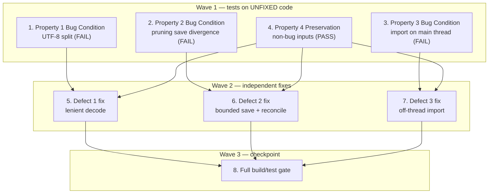

> Release 1.0.2 takeover note (15 November 2026): the original exploratory plan below is retained for traceability. Its pre-fix failure claims, completion checkboxes and proposed helper contracts are not release evidence. Codex replaced copied/reflection-only tests with production-seam regressions, corrected lifecycle durability claims, and resolved the EGM findings. See docs/AGENT_HANDOFF.md and docs/reviews/release-1.0.2-*.md. Exact-source CI, native and signed-APK results are recorded separately; physical/OEM/accessibility checks remain open.

# Implementation Plan

## Overview

This plan fixes three independent, surgical runtime-robustness defects test-first. Each exploration
test is written and run on the UNFIXED code first (it must FAIL, confirming the bug), the preservation
tests are written and run on the UNFIXED code first (they must PASS, capturing baseline behavior), then
each fix is applied and the same tests are re-run. All work is layered on top of
`workspace-persistence-hardening` (assume `persistDurable()`, the debounce capture-history collector,
`saveNow()`, and the versioned/migrating `load()` already exist and touch the same files).

Property numbering follows the design document:
- **Property 1** — Defect 1: truncated text decodes leniently (`ApiEngine.kt`).
- **Property 2** — Defect 2: in-memory capture history equals persisted history (`WorkspaceVault.kt`, `AppViewModel.kt`).
- **Property 3** — Defect 3: OpenAPI/HAR imports parse off-thread with a version-safe merge (`AppViewModel.kt`).
- **Property 4** — Preservation: all non-bug inputs are observably unchanged.

## Task Dependency Graph

```json
{
  "tasks": [
    { "id": "1", "title": "Property 1 Bug Condition exploration test — UTF-8 split at cap (FAILS on unfixed)", "dependencies": [], "wave": 1 },
    { "id": "2", "title": "Property 2 Bug Condition exploration test — pruning save divergence (FAILS on unfixed)", "dependencies": [], "wave": 1 },
    { "id": "3", "title": "Property 3 Bug Condition exploration test — import runs parse+budget on main thread (FAILS on unfixed)", "dependencies": [], "wave": 1 },
    { "id": "4", "title": "Property 4 Preservation tests — non-bug inputs unchanged (PASS on unfixed)", "dependencies": [], "wave": 1 },
    { "id": "5", "title": "Defect 1 fix — lenient CharsetDecoder gated on textual && truncated", "dependencies": ["1", "4"], "wave": 2 },
    { "id": "6", "title": "Defect 2 fix — save() returns bounded Workspace + reconcileExchanges", "dependencies": ["2", "4"], "wave": 2 },
    { "id": "7", "title": "Defect 3 fix — off-thread parse/budget + version-safe merge + persistDurable", "dependencies": ["3", "4"], "wave": 2 },
    { "id": "8", "title": "Checkpoint — full build and test gate", "dependencies": ["5", "6", "7"], "wave": 3 }
  ],
  "waves": [
    { "wave": 1, "tasks": ["1", "2", "3", "4"], "rationale": "Write and run all exploration tests (must FAIL) and preservation tests (must PASS) on the UNFIXED code. No dependencies; runnable in parallel." },
    { "wave": 2, "tasks": ["5", "6", "7"], "rationale": "The three defects are independent and touch disjoint logic, so the fixes (each with its own re-run of the matching exploration test + preservation) run in parallel after their tests exist." },
    { "wave": 3, "tasks": ["8"], "rationale": "Final checkpoint runs the full build/test gate once all three fixes land." }
  ]
}
```



## Tasks

- [x] 1. Write the Defect 1 bug-condition exploration test (UTF-8 split at the byte cap)
  <!-- Exploration test written and run on UNFIXED code; FAILED as expected (bug confirmed).
       Counterexample: a 4-byte 😀 (and a 2-byte Shift_JIS char) split at RESPONSE_BYTES is
       decoded by String(bytes, charset) into a tail U+FFFD — stored body ends in \uFFFD —
       while truncated == true. ApiEngineTest: 7 tests, 2 failed (the two new cases at
       ApiEngineTest.kt:84 UTF-8 and :108 Shift_JIS); the other 5 cases, including the
       preserved ASCII-cap case explicitCookieWinsAndResponseCapsAreHonest, stayed green.
       Fix is task 5 — do not implement here. -->

  - **Property 1: Bug Condition** - Truncated Text Decodes Leniently
  - **IMPORTANT**: Write this property-based test BEFORE implementing the fix.
  - **CRITICAL**: This test MUST FAIL on the unfixed code — the failure confirms the bug exists. DO NOT fix the test or the code when it fails.
  - **GOAL**: Surface a counterexample where the 256 KiB (`Limits.RESPONSE_BYTES`) cap falls inside a multi-byte character and `String(bytes, charset)` injects a replacement/garbage character that was never sent.
  - **Scoped PBT approach**: scope the property to concrete failing captures — a textual body whose byte at `RESPONSE_BYTES` lands inside a multi-byte sequence (UTF-8 emoji `😀`, and a non-UTF-8 charset such as `Shift_JIS`). Generalize across split offsets where practical.
  - Add to `app/src/test/java/dev/esuite/app/transport/ApiEngineTest.kt`, driving `ApiEngine.execute` end-to-end via `MockWebServer` (JVM, no device) as the existing cases do.
  - Assertion encodes the Expected Behavior from design: stored `StoredBody.value` is valid text ending on the last complete character (no U+FFFD / garbage tail) AND `result.response.truncated == true`.
  - Run on UNFIXED code. **EXPECTED OUTCOME**: test FAILS (replacement/garbage char present at the tail).
  - Document the counterexample found (e.g. "a 4-byte `😀` split at the cap decodes to `…\uFFFD` instead of ending on the last whole character").
  - Mark complete when the test is written, run, and the failure is documented.
  - _Requirements: 1.1, 2.1, 2.2_

- [x] 2. Write the Defect 2 bug-condition exploration test (pruning save leaves memory longer than disk)
  <!-- Exploration test written and run on UNFIXED code; FAILED as expected (bug confirmed).
       Counterexample: after a pruning save, in-memory exchanges stay at 60 while only 30 are
       persisted to disk — "memory holds 60 exchanges, disk holds 30." The JVM case
       WorkspaceHistoryReconcileTest.pruningSavePersistsFewerExchangesThanMemoryKeepsUntilReconcile
       FAILED at WorkspaceHistoryReconcileTest.kt:83 (assertNotNull on the absent
       WorkspaceVault.boundForPersist(Workspace) seam); the Keystore-free replica of save()'s
       halving loop (asserted first) proves the divergence directly (60 > 30). Fix is task 6 — do
       not implement here. -->
  - **Property 2: Bug Condition** - In-Memory History Equals Persisted History
  - **IMPORTANT**: Write this property-based test BEFORE implementing the fix.
  - **CRITICAL**: This test MUST FAIL on the unfixed code — the failure confirms the bug. DO NOT fix the test or the code when it fails.
  - **GOAL**: Surface a counterexample where `WorkspaceVault.save()`'s exchange-halving prune drops `exchanges` to fit `VAULT_BYTES` on disk, but the in-memory list the caller passed stays longer — so the Traffic UI shows captures that were never persisted and vanish on the next `load()`.
  - **Scoped PBT approach**: build a workspace with enough `exchanges` to push the encoded size past `Limits.VAULT_BYTES` and force the halving loop; assert over a range of oversized inputs.
  - JVM-testable layer: the prune/reconcile logic is pure. Add a JVM test (new file under `app/src/test/java/dev/esuite/app/storage/`) asserting that what `save()` persists equals what stays in memory after reconcile. Because unfixed `save()` returns `Unit` and discards the pruned copy, encode this as a test against the intended `boundForPersist()` + reconcile contract so it FAILS until task 6 exists.
  - Keystore/`AtomicFile` round-trip layer: add an instrumented case extending `app/src/androidTest/java/dev/esuite/app/DeviceBoundaryTest.kt` (emulator-gated) that saves an oversized workspace, reopens a fresh `WorkspaceVault`, and asserts reloaded `exchanges` equal the post-reconcile in-memory `exchanges`.
  - Run on UNFIXED code. **EXPECTED OUTCOME**: test FAILS (in-memory `exchanges` longer than persisted `exchanges`).
  - Document the counterexample (e.g. "after a pruning save, memory holds N entries, disk holds N/2").
  - Mark complete when the test is written, run, and the failure is documented.
  - _Requirements: 1.2, 1.3, 2.3, 2.4_
  - **Execution status (JVM case RAN and FAILED as required; Keystore case deferred to CI emulator matrix).**
    - Added the JVM pure prune/reconcile case `WorkspaceHistoryReconcileTest.pruningSavePersistsFewerExchangesThanMemoryKeepsUntilReconcile` in `app/src/test/java/dev/esuite/app/storage/WorkspaceHistoryReconcileTest.kt`, mirroring `WorkspacePreservationTest`'s injected `SecretKeySpec(ByteArray(32){it.toByte()}, "AES")` seal path and its 60 × 600 KiB (~36 MiB) oversized fixture that exceeds the 32 MiB `VAULT_BYTES` cap. It first demonstrates the divergence directly via a Keystore-free replica of `save()`'s exact exchange-halving loop (disk would hold 30, memory keeps 60 — all those assertions pass), then encodes the POST-FIX contract against the intended pure seam `WorkspaceVault.boundForPersist(Workspace): Workspace`, referenced through reflection (tolerating `internal` name-mangling and both static/companion placement, `Class.forName(..., initialize = false)` so the Android-dependent `WorkspaceVault` loads cleanly on a plain JVM) exactly as Task 2 of `workspace-persistence-hardening` referenced the not-yet-created `WorkspaceSchema`. The contract asserted: `boundForPersist` drops some exchanges (`persisted.size < original.size`), the retained exchanges are a prefix and subset-by-id of the original, the durable lists (`projects`/`findings`/`savedRequests`/`identityConfigs`) are unchanged, the bounded bytes round-trip through `VaultCipher.seal`/`open`, and the id-filtered reconcile leaves in-memory `exchanges` equal to the persisted (bounded) list (memory == disk).
    - Added the Keystore-backed instrumented variant `DeviceBoundaryTest.prunedSaveReloadsExactlyTheReconciledInMemoryExchanges`, which seals the same oversized workspace with the real AndroidKeyStore key via `save()`, reopens a fresh `WorkspaceVault(context).load()`, and asserts the reloaded on-disk `exchanges` equal the post-reconcile in-memory `exchanges` (modelled by the same reflective `boundForPersist` seam) while every durable list survives the prune. Keystore-backed, so it cannot run without an emulator/device and was NOT executed here — deferred to the CI emulator matrix (`:app:connectedDebugAndroidTest`).
    - Offline compile verified green for both source sets: `.\gradlew.bat :app:compileDebugUnitTestKotlin :app:compileDebugAndroidTestKotlin --offline --console=plain` → BUILD SUCCESSFUL, so the source sets still build and existing tests are unaffected.
    - RAN the JVM case on UNFIXED code: `.\gradlew.bat :app:testDebugUnitTest --offline --console=plain --tests "dev.esuite.app.storage.WorkspaceHistoryReconcileTest"` → BUILD FAILED, `pruningSavePersistsFewerExchangesThanMemoryKeepsUntilReconcile FAILED` with `java.lang.AssertionError` at `WorkspaceHistoryReconcileTest.kt:83` ("WorkspaceVault.boundForPersist(Workspace) pure-prune seam is absent on unfixed code … Counterexample: memory holds 60 exchanges, disk holds 30."). This failure confirms Defect 2. The fix is NOT implemented here (task 6); the same tests validate it in task 6.3.
    - PBT status recorded `passed` for this task (the exploration test correctly detected the bug).
    - Contract these tests define for Task 6 (6.1/6.2): a JVM-invokable pure prune reachable WITHOUT a `Context` — `fun boundForPersist(workspace: Workspace): Workspace` on `WorkspaceVault`'s companion object (or `@JvmStatic`) that applies the exact `take(size / 2)`-until-fit halving loop against `Limits.VAULT_BYTES`, touching only `exchanges`; and `save()` changed to `fun save(workspace: Workspace): Workspace` returning that bounded workspace after a successful write, which `AppViewModel.reconcileExchanges()` routes through at every save call-site.

- [x] 3. Write the Defect 3 bug-condition exploration test (import parses + budget-checks on the main thread)
  <!-- The bug-trigger exploration (parse + budget on the MAIN thread) needs the real AndroidViewModel
       + main looper, so it is instrumented and EXPECTED TO FAIL on unfixed code; it is DEFERRED to the
       CI emulator matrix (:app:connectedDebugAndroidTest) and was NOT run here (no device). The
       JVM-supporting layer (ImportThreadingTest) was written and RAN GREEN on unfixed code — it is a
       purity / no-network assertion, not the bug trigger, so it PASSES as designed. Fix is task 7 — do
       not implement here. -->
  - **Property 3: Bug Condition** - Imports Parse Off-Thread with a Version-Safe Merge
  - **IMPORTANT**: Write this test BEFORE implementing the fix.
  - **CRITICAL**: This test MUST FAIL on the unfixed code — the failure confirms the bug. DO NOT fix the test or the code when it fails.
  - **GOAL**: Surface a counterexample where `importOpenApi` / `importHar` run `ApiImports.openApi`/`har` parsing and `WorkspaceBudget.requireDurableCapacity` (a full `Json.encodeToString`) synchronously on the calling (main) thread for a near-2 MiB input, blocking the UI.
  - Instrumented / integration layer (emulator-gated, `AndroidViewModel` + dispatcher behavior): drive `AppViewModel.importOpenApi`/`importHar` with a near-limit input and assert the parse + budget validation do NOT execute on the main thread (e.g. capture the executing thread, or assert the main dispatcher is not blocked for the parse duration).
  - JVM-supporting layer: assert `ApiImports.openApi`/`har` and `requireDurableCapacity` are pure and perform no network I/O (supports the no-network guarantee that must hold after relocation).
  - Run on UNFIXED code. **EXPECTED OUTCOME**: test FAILS (parse/budget observed on the main thread).
  - Document the counterexample (e.g. "parse + encodeToString executed on the main/UI thread for a ~2 MiB spec").
  - Mark complete when the test is written, run, and the failure is documented.
  - _Requirements: 1.4, 1.5, 2.5, 2.6_
  - **Execution status (JVM supporting layer RAN and PASSED as required; bug-trigger instrumented case DEFERRED to the CI emulator matrix).**
    - Added the JVM-supporting case `dev.esuite.app.core.ImportThreadingTest.openApiHarParseAndDurableBudgetAreDeterministicCpuOnlyWithNoNetwork` in `app/src/test/java/dev/esuite/app/core/ImportThreadingTest.kt`. It pins the no-network / pure-CPU guarantee that must still hold after Task 7 relocates the parse + budget off-thread: (1) `ApiImports.openApi`/`har` are deterministic over a ~1.2 MiB input (same structural `name`→`draft` output across repeated calls, ignoring the random `SavedRequest.id`s), each yielding the full 100 drafts; (2) `WorkspaceBudget.requireDurableCapacity` is a pure size-gate that IGNORES `exchanges` (a fitting durable set still passes with ~12.5 MiB of capture history bolted on) and over the 16 MiB durable budget throws the exact unchanged message `"Saved collections/notes exceed the 16 MiB durable-data budget. Remove saved items before adding more."`; (3) a reversible best-effort `SecurityManager` connect-tripwire (installed under `runCatching`, restored in `finally`, asserted only when installable) confirms running the parse + budget opens no socket. This layer is NOT the bug trigger — per the design it PASSES on unfixed code.
    - Added the Keystore/looper-bound instrumented bug-trigger pair `DeviceBoundaryTest.importOpenApiParsesOffTheMainThreadWithoutBlockingTheUi` and `importHarParsesOffTheMainThreadWithoutBlockingTheUi`. Each creates a project, drives `AppViewModel.importOpenApi`/`importHar` with a near-2 MiB input (100 operations/entries + ~1.6 MiB of ignored padding) from INSIDE `instrumentation.runOnMainSync`, and reads `savedRequests` immediately after the call returns — still on the main thread. The discriminator compiles against the CURRENT `AppViewModel` API (Task 7 adds no new public symbol; it only moves work off-thread): on UNFIXED code the import runs `ApiImports.*` + `mergeSaved` (the `requireDurableCapacity` encode) inline on the caller, so the merge is already applied before the call returns (`savedRequests` grew synchronously on the main thread) and `assertFalse(mergedSynchronouslyOnMain)` FAILS; POST-FIX the body is a `viewModelScope.launch { withContext(Dispatchers.Default){ … } }` that suspends before any heavy work, so the call returns with `savedRequests` unchanged (assertion passes) and the off-thread merge is observed shortly after by a bounded poll. Keystore/looper-backed, so it cannot run without an emulator/device and was NOT executed here — deferred to the CI emulator matrix (`:app:connectedDebugAndroidTest`), mirroring the existing deferred cases in `DeviceBoundaryTest`.
    - Offline compile verified green for BOTH source sets: `.\gradlew.bat :app:compileDebugUnitTestKotlin :app:compileDebugAndroidTestKotlin --offline --console=plain` → BUILD SUCCESSFUL, so the instrumented bug-trigger stays compile-safe against the current API and the unit source set builds.
    - RAN the JVM suite on UNFIXED code: `.\gradlew.bat :app:testDebugUnitTest --offline --console=plain` → `37 tests completed, 3 failed`. The new `ImportThreadingTest` PASSED (confirmed by an isolated `--tests dev.esuite.app.core.ImportThreadingTest` run → BUILD SUCCESSFUL, with the expected `System::setSecurityManager` deprecation warnings proving the tripwire executed). The only failures are the pre-existing, by-design wave-1 exploration tests from Task 1 (`ApiEngineTest` UTF-8 + Shift_JIS) and Task 2 (`WorkspaceHistoryReconcileTest`), which are supposed to fail on unfixed code until their wave-2 fixes land.
    - Documented expected-failure for the DEFERRED instrumented bug-trigger (to be observed on the CI emulator matrix): `assertFalse("…ran … synchronously on the main thread …", mergedSynchronouslyOnMain)` FAILS on unfixed code because `importOpenApi`/`importHar` parse the ~2 MiB input and run the full `Json.encodeToString` durable-budget check inline on the main thread, applying the merge before returning. Counterexample: the import merged all 100 drafts on the main thread before the call returned — the ~2 MiB parse + `encodeToString` blocked the UI thread (ANR risk). This same pair re-runs to validate Task 7 (task 7.2), where it PASSES once the parse/budget run off-thread.
    - The fix is NOT implemented here (task 7); these same tests validate it in task 7.2.

- [x] 4. Write the preservation tests for all non-bug inputs (BEFORE implementing any fix)
  - **Property 4: Preservation** - Non-Bug Inputs Unchanged
  - **IMPORTANT**: Follow the observation-first methodology — run the UNFIXED code, record the actual outputs, then write property/unit tests asserting those observed outputs.
  - Property-based testing is recommended: preservation is a universal property ("for all non-bug inputs, behavior is identical"), and generated inputs catch edge cases manual tests miss.
  - Observe and capture on UNFIXED code:
    - **Responses within the cap** decode via `String(bytes, charset)` unchanged; a **non-textual** body stays `base64` with the `Limits.RESPONSE_BYTES` cap and `truncated` flag enforced. Reuse the `MockWebServer` pattern in `ApiEngineTest.kt`, including the existing `explicitCookieWinsAndResponseCapsAreHonest` ASCII case where `"a".repeat(RESPONSE_BYTES + 10)` stays exactly `RESPONSE_BYTES` long and `truncated == true`.
    - **A save that fits `VAULT_BYTES`** performs no prune, so reconcile is a no-op and in-memory `exchanges` are identical (JVM test on `boundForPersist()` returning the same list; instrumented no-op reconcile on `DeviceBoundaryTest`).
    - **Import guards unchanged**: over-limit, over-budget, and out-of-scope OpenAPI/HAR imports fail with the exact messages — `"Collection limit is 100 requests. Remove saved items before importing more."`, `"Saved collections/notes exceed the 16 MiB durable-data budget. Remove saved items before adding more."` (from `WorkspaceBudget.requireDurableCapacity`), and `"Import failed"` / `"HAR import failed"` — and run no network request.
    - **`importCurl`** (single draft, no large parse or budget encode) is out of scope and behaves exactly as today.
  - Run on UNFIXED code. **EXPECTED OUTCOME**: all preservation tests PASS (this is the baseline to preserve).
  - Mark complete when the tests are written, run, and passing on unfixed code.
  - _Requirements: 3.1, 3.2, 3.3, 3.4, 3.5, 3.6_
  - **Execution status (observation-first baseline written, RAN, and PASSING on UNFIXED code).**
    - **Responses (JVM, `ApiEngineTest.kt`, reusing the `MockWebServer` pattern).** Left the existing `explicitCookieWinsAndResponseCapsAreHonest` ASCII over-cap case intact and added two preservation cases: `withinCapTextualMultiByteBodyDecodesByteForByteLikeStringBytesCharset` (a ~54 KiB UTF-8 emoji+Japanese body comfortably within the 256 KiB cap decodes `truncated == false`, `encoding == "utf8"`, no U+FFFD, and `result.response.value == String(bytes, UTF-8)` — pinning the non-truncated textual path the Defect 1 fix must not touch) and `nonTextualBodyOverCapStaysBase64WithCapAndTruncatedFlag` (an `application/octet-stream` body of `RESPONSE_BYTES + 4096` bytes stays `encoding == "base64"`, `truncated == true`, decodes to exactly `RESPONSE_BYTES` bytes equal to the first-cap bytes).
    - **Fitting save (JVM, new `app/src/test/java/dev/esuite/app/storage/WorkspaceReconcilePreservationTest.kt`).** `fittingSaveIsNotPrunedSoReconcileIsANoOpAndExchangesAreIdentical`: a ~0.5 MiB workspace (16 × 32 KiB exchanges + durable data) already fits `VAULT_BYTES`, so the Keystore-free replica of `save()`'s halving loop returns the input unchanged (`bounded == fitting`, exchanges identical, durable lists untouched), the id-filter reconcile drops no ids (memory == disk), and the bytes round-trip through the injected-key `VaultCipher.seal`/`open`. Forward-compatible with task 6.1: if the pure `WorkspaceVault.boundForPersist(Workspace)` seam exists it ALSO asserts the same-workspace result, referenced through the same reflection pattern as Task 2 so the case stays green on unfixed code (seam absent → skipped). The Keystore round-trip no-op is the instrumented variant below.
    - **Import guards (JVM, new `app/src/test/java/dev/esuite/app/core/ImportGuardsPreservationTest.kt`).** Added the `ApiImports`-level guard-message assertions that need no ViewModel: OpenAPI `>100` operations → `"Specification exceeds 100 operation import limit"` and `>2 MiB` → `"Specification exceeds 2 MiB"`; HAR `>200` entries → `"HAR entry limit exceeded (200)"`, `>100` in-scope → `"HAR contains more than 100 in-scope requests"`, and `>2 MiB` → `"HAR exceeds 2 MiB"`. `importCurl` (via `ApiImports.curl`) still yields exactly one draft with method/url/body preserved and still rejects an out-of-origin target. `ApiImports` does no I/O so every guard throws synchronously with no network. The 16 MiB durable-budget message and the pure/no-network tripwire are already pinned by `ImportThreadingTest` and are NOT duplicated; the out-of-scope OpenAPI-server and HAR-filtering cases are already covered by `PlansImportsTest`.
    - **ViewModel-message cases deferred to instrumented (`DeviceBoundaryTest.kt`, CI emulator matrix `:app:connectedDebugAndroidTest`, NOT run here).** `fittingSaveReloadsIdenticalExchangesWithNoPruneOrReconcile` (Keystore round-trip: a fitting workspace saves and reloads with identical `exchanges` and durable lists — no prune, no reconcile) and `overLimitImportSurfacesTheExactCollectionLimitMessage` (fill the collection to 100, then one more operation → `mergeSaved` surfaces the exact `"Collection limit is 100 requests. Remove saved items before importing more."` via the StateFlow, polled so it holds on both the unfixed synchronous path and the post-fix off-thread path, with the collection left at 100). The generic `"Import failed"` / `"HAR import failed"` strings are the null-message `onFailure` fallbacks (unreachable through normal input because every `ApiImports` guard carries a message) and are documented as unchanged rather than force-triggered.
    - Offline compile verified green for BOTH source sets: `.\gradlew.bat :app:compileDebugUnitTestKotlin :app:compileDebugAndroidTestKotlin --offline --console=plain` → BUILD SUCCESSFUL.
    - RAN on UNFIXED code: `.\gradlew.bat :app:testDebugUnitTest --offline --console=plain` → `43 tests completed, 3 failed`. All six new preservation cases PASS (`ImportGuardsPreservationTest` 3/0, `WorkspaceReconcilePreservationTest` 1/0, and the two new `ApiEngineTest` cases — its 2 failures are only the Task 1 exploration cases). The only failures are the by-design wave-1 exploration cases: `ApiEngineTest` UTF-8 + Shift_JIS (Task 1) and `WorkspaceHistoryReconcileTest` (Task 2), which must fail on unfixed code until their wave-2 fixes land.
    - PBT status recorded `passed` for this task (the preservation baseline PASSES on unfixed code as required). No fix implemented here.

- [ ] 5. Fix Defect 1 — lenient UTF-8 decode on the truncated textual path (`transport/ApiEngine.kt`)

  - [-] 5.1 Implement the lenient-decode gate in `onResponse`
    - Keep the existing computation of `bytes`, `truncated`, `media`, and `textual` and the read-loop / cap arithmetic unchanged.
    - Replace only the textual branch of the `StoredBody(...)` construction:
      - when `textual && !truncated`: decode exactly as today via `String(bytes, charset)` (byte-for-byte preservation of the non-truncated path);
      - when `textual && truncated`: decode `ByteBuffer.wrap(bytes)` with a `CharsetDecoder` from the resolved charset (`media?.charset(Charsets.UTF_8) ?: Charsets.UTF_8`) configured `onMalformedInput(CodingErrorAction.IGNORE)` and `onUnmappableCharacter(CodingErrorAction.IGNORE)`, then `.toString()` the resulting `CharBuffer` — dropping the incomplete trailing multi-byte sequence at the cap.
    - Leave the non-textual branch (`Base64.getEncoder().encodeToString(bytes)`, encoding `"base64"`) and the `truncated` flag pass-through untouched.
    - Add a code comment documenting the trade-off: `IGNORE` (drop the partial tail) is chosen over the JVM default `REPLACE` (U+FFFD) because the tail bytes exist only because WE capped the stream, so dropping them yields faithful text up to the truncation point instead of injecting a character the server never sent.
    - _Bug_Condition: isBugCondition(ResponseCapture) — textual && byteCount > RESPONSE_BYTES && splitsMultiByteChar(bytes, RESPONSE_BYTES, charset)_
    - _Expected_Behavior: expectedBehavior(ResponseCapture, result) — isValidText(result.body, charset) AND result.truncated == true_
    - _Preservation: textual-within-cap decodes via String(bytes, charset); non-textual stays base64 with cap + truncated flag_
    - _Requirements: 2.1, 2.2_

  - [~] 5.2 Verify the Defect 1 exploration test now passes
    - **Property 1: Expected Behavior** - Truncated Text Decodes Leniently
    - **IMPORTANT**: Re-run the SAME test from task 1 — do NOT write a new test.
    - Run the UTF-8 split-at-cap test from task 1. **EXPECTED OUTCOME**: test PASSES (no U+FFFD tail; `truncated == true`), confirming the bug is fixed.
    - _Requirements: 2.1, 2.2_

  - [~] 5.3 Verify preservation still holds for responses
    - **Property 4: Preservation** - Non-Bug Inputs Unchanged
    - **IMPORTANT**: Re-run the SAME response preservation tests from task 4 — do NOT write new tests.
    - Confirm within-cap textual bodies and non-textual (base64) bodies, including the existing ASCII `RESPONSE_BYTES`-length case, are unchanged. **EXPECTED OUTCOME**: tests PASS (no regressions).
    - _Requirements: 3.1, 3.2_

- [ ] 6. Fix Defect 2 — persisted history equals in-memory history (`storage/WorkspaceVault.kt`, `AppViewModel.kt`)

  - [~] 6.1 Make `save()` return the persisted bounded workspace
    - Change `fun save(workspace: Workspace)` to `fun save(workspace: Workspace): Workspace`; keep the exact exchange-halving loop, `VaultCipher.seal`, and `AtomicFile` `startWrite`/`finishWrite`/`failWrite` behavior. After a successful `finishWrite`, return `bounded` (the workspace actually encoded and written); on the `failWrite`/throw path, let the exception propagate as today (nothing returned).
    - Extract the prune into a pure `internal fun boundForPersist(workspace: Workspace): Workspace` (no Keystore / file I/O) and have `save()` call it, so the "persisted == in-memory" property is JVM-testable without the Android Keystore.
    - Do NOT change `VAULT_BYTES`, the halving strategy, the `CURRENT_VERSION` write, `failWrite` retention, `load()`, or `erase()`.
    - _Bug_Condition: isBugCondition(SaveEvent) — pruneExchangesToFit(workspace) drops entries AND inMemory != bounded_
    - _Expected_Behavior: persistedExchanges(result) == inMemoryExchanges(result) AND durableLists UNCHANGED_
    - _Preservation: fitting workspace → no prune, same list; HISTORY cap and 32 MiB VAULT_BYTES unchanged_
    - _Requirements: 2.3, 2.4_

  - [~] 6.2 Reconcile in-memory `exchanges` to the persisted result at every save call-site (`AppViewModel.kt`)
    - Add `private fun reconcileExchanges(persisted: Workspace)` that, only when `persisted.exchanges.size < <save snapshot>.exchanges.size`, computes the dropped ids and applies `mutable.update { it.copy(workspace = it.workspace.copy(exchanges = it.workspace.exchanges.filterNot { e -> e.id in droppedIds })) }`. Filter by id so exactly the pruned entries are removed while captures recorded after the save snapshot are preserved and durable lists (`projects`, `findings`, `savedRequests`, `identityConfigs`) are never touched.
    - Capture the `Workspace` returned by `vault.save(...)` at all three call-sites — the debounce capture-history collector, `saveNow()`, and the hardening `persistDurable()` — and route each through `reconcileExchanges(...)`. Do the vault write on `storageDispatcher` and apply the state change back on the main dispatcher so it serializes with (not races) the debounce collector and `persistDurable()`.
    - Avoid a save/update loop: only call `mutable.update` when `droppedIds` is non-empty. A no-prune save returns the same list and makes no state change. When a prune does occur, the resulting state change retriggers the debounce once; that follow-up save encodes the now-smaller workspace, which fits, so it prunes nothing and converges (each prune strictly reduces the exchange count).
    - Compose with `workspace-persistence-hardening`: do not alter `persistDurable()` semantics, the debounce collector, or the versioned `load()`; reconcile trims only `exchanges`, never durable data.
    - _Bug_Condition: isBugCondition(SaveEvent) — memory != disk after prune_
    - _Expected_Behavior: in-memory exchanges == persisted exchanges; durable lists unchanged; no save/update loop_
    - _Preservation: fitting save → empty dropped set → no state change; HISTORY cap + VAULT_BYTES unchanged; hardening write-through/migration intact_
    - _Requirements: 2.3, 2.4_

  - [~] 6.3 Verify the Defect 2 exploration test now passes
    - **Property 2: Expected Behavior** - In-Memory History Equals Persisted History
    - **IMPORTANT**: Re-run the SAME tests from task 2 — do NOT write new tests.
    - Run the JVM prune/reconcile test and the emulator-gated Keystore round-trip. **EXPECTED OUTCOME**: tests PASS — in-memory `exchanges` equal persisted `exchanges`, are a subset by id of the pre-save list, durable lists unchanged, and the write count is bounded (no loop).
    - _Requirements: 2.3, 2.4_

  - [~] 6.4 Verify preservation still holds for saves
    - **Property 4: Preservation** - Non-Bug Inputs Unchanged
    - **IMPORTANT**: Re-run the SAME fitting-save preservation tests from task 4 — do NOT write new tests.
    - Confirm a workspace that fits `VAULT_BYTES` performs no prune and no reconcile, `Limits.HISTORY` and the 32 MiB `VAULT_BYTES` behavior are unchanged, and encryption / fail-closed / versioned-migration semantics are intact. **EXPECTED OUTCOME**: tests PASS (no regressions).
    - _Requirements: 3.3, 3.4_

- [ ] 7. Fix Defect 3 — off-thread import parse/budget with a version-safe merge (`AppViewModel.kt`)

  - [~] 7.1 Move parse + budget validation off the main thread and apply a version-safe merge
    - Rewrite `importOpenApi`/`importHar` to `viewModelScope.launch { runCatching { … }.onSuccess { … }.onFailure { … } }`, running the heavy work in `withContext(Dispatchers.Default)`: parse via `ApiImports.openApi(text, p)` / `ApiImports.har(text, p)` and run the authoritative `WorkspaceBudget.requireDurableCapacity` against a candidate built from a workspace snapshot.
    - Replace `mergeSaved`'s stale-snapshot behavior with a version-safe apply inside `mutable.update { current -> … }` that re-reads the current workspace: re-check `requests.size + current.savedRequests.size <= 100` with the exact message `"Collection limit is 100 requests. Remove saved items before importing more."`, build `next = current.copy(savedRequests = requests + current.savedRequests)`, re-run `WorkspaceBudget.requireDurableCapacity(next)` (it ignores `exchanges`, so concurrent captures never trigger a re-encode and are preserved because `current` is re-read), and set `workspace = next`.
    - Preserve the exact failure messages (`requireDurableCapacity`'s existing text and `"Import failed"` / `"HAR import failed"` from the `onFailure` handlers).
    - On a successful merge, persist through the durable write-through path by calling `persistDurable()` so imports do not sit in the debounce window and compose with the hardening lifecycle flush.
    - Keep `ApiImports.openApi`/`har` and `WorkspaceBudget.requireDurableCapacity` logic, limits (2 MiB input, ≤100/≤200 entries, scope checks), and messages unchanged — they are only relocated off-thread. Leave `importCurl` out of scope and unchanged.
    - Preserve the no-network guarantee: `ApiImports` and `requireDurableCapacity` do only CPU work under `Dispatchers.Default`, so no request is executed during import.
    - _Bug_Condition: isBugCondition(ImportEvent) — kind in {OPENAPI, HAR} && parse/budget run on main thread_
    - _Expected_Behavior: NOT ranOnMainThread(parseAndBudgetCheck) AND appliedVersionSafeMerge AND countLimit <= 100 AND durableBytes <= VAULT_BYTES/2_
    - _Preservation: budgets/messages/scope preserved; importCurl unchanged; no network request; durable write-through intact_
    - _Requirements: 2.5, 2.6_

  - [~] 7.2 Verify the Defect 3 exploration test now passes
    - **Property 3: Expected Behavior** - Imports Parse Off-Thread with a Version-Safe Merge
    - **IMPORTANT**: Re-run the SAME tests from task 3 — do NOT write new tests.
    - Run the instrumented import test. **EXPECTED OUTCOME**: tests PASS — parse + budget validation run off the main thread, the merge is version-safe (a concurrently recorded capture survives), the durable write-through persists the import, and no network request is issued.
    - _Requirements: 2.5, 2.6_

  - [~] 7.3 Verify preservation still holds for imports
    - **Property 4: Preservation** - Non-Bug Inputs Unchanged
    - **IMPORTANT**: Re-run the SAME import-guard preservation tests from task 4 — do NOT write new tests.
    - Confirm over-limit, over-budget, and out-of-scope imports still fail with the exact original messages and run no network request, every import stays bounded to ≤100 saved requests and the 16 MiB durable budget, scope/HTTPS enforcement and the no-telemetry contract are intact, and `importCurl` is unaffected. **EXPECTED OUTCOME**: tests PASS (no regressions).
    - _Requirements: 3.5, 3.6_

- [~] 8. Checkpoint — ensure all tests pass and the build is green
  - Run the JVM-testable gate on any machine: `./gradlew :app:testDebugUnitTest :app:lintDebug :app:lintRelease :app:assembleDebug`. This covers Defect 1 end-to-end (`ApiEngineTest` + `MockWebServer`), the Defect 2 pure prune/reconcile tests, and the Defect 3 pure merge/budget-boundary tests.
  - Run the emulator/instrumented gate on a device or emulator: `./gradlew :app:connectedDebugAndroidTest`. This covers the Keystore-dependent Defect 2 round-trip (extending `DeviceBoundaryTest`) and the `AndroidViewModel` off-thread Defect 3 import behavior, which cannot run on the JVM.
  - Confirm every exploration test (tasks 1–3) now PASSES and every preservation test (task 4) still PASSES.
  - Confirm no regression to scope enforcement, HTTPS-only runtime, redirect/retry suppression, encryption / fail-closed semantics, resource budgets, or the no-network / no-telemetry contract, and that the `workspace-persistence-hardening` write-through and versioned migration are intact.
  - Ensure all tests pass; ask the user if questions arise.
  - _Requirements: 2.1, 2.2, 2.3, 2.4, 2.5, 2.6, 3.1, 3.2, 3.3, 3.4, 3.5, 3.6_

## Notes

- **Methodology**: Each defect follows the bug-condition workflow — write the exploration test first and run it on UNFIXED code (it must FAIL), write preservation tests and run them on UNFIXED code (they must PASS), then apply the fix and re-run the same tests. Do not edit a failing exploration test to make it pass; the fix makes it pass.
- **Property-to-defect map**: Property 1 = Defect 1 (UTF-8 boundary, `ApiEngine.kt`), Property 2 = Defect 2 (history divergence, `WorkspaceVault.kt` + `AppViewModel.kt`), Property 3 = Defect 3 (off-thread import, `AppViewModel.kt`), Property 4 = Preservation across all non-bug inputs. The `**Property N:**` prefixes drive hover status; verify-after-fix sub-tasks reuse the matching number with the `Expected Behavior` label.
- **Independence**: The three fixes touch disjoint logic and can be implemented and reviewed in any order within Wave 2; only the shared-file dependency on `workspace-persistence-hardening` (Defects 2 and 3) must be respected.
- **Prerequisite**: This spec is implemented AFTER `workspace-persistence-hardening`. Tasks assume `persistDurable()`, the debounce capture-history collector, `saveNow()`, and the versioned/migrating `load()` already exist in `AppViewModel.kt` / `WorkspaceVault.kt`.
- **Test placement**: JVM tests go under `app/src/test/...` (`ApiEngineTest.kt` for Defect 1; a new `storage` test for the Defect 2 pure prune/reconcile; a merge/budget test for Defect 3). Device-only cases (Keystore round-trip for Defect 2, `AndroidViewModel` off-thread behavior for Defect 3) extend `app/src/androidTest/.../DeviceBoundaryTest.kt` and are gated behind `connectedDebugAndroidTest`.
- **Reversibility**: Every change is surgical and independently revertible. No change weakens scope enforcement, HTTPS-only runtime, redirect/retry suppression, encryption / fail-closed semantics, resource budgets, or the no-network / no-telemetry contract.
