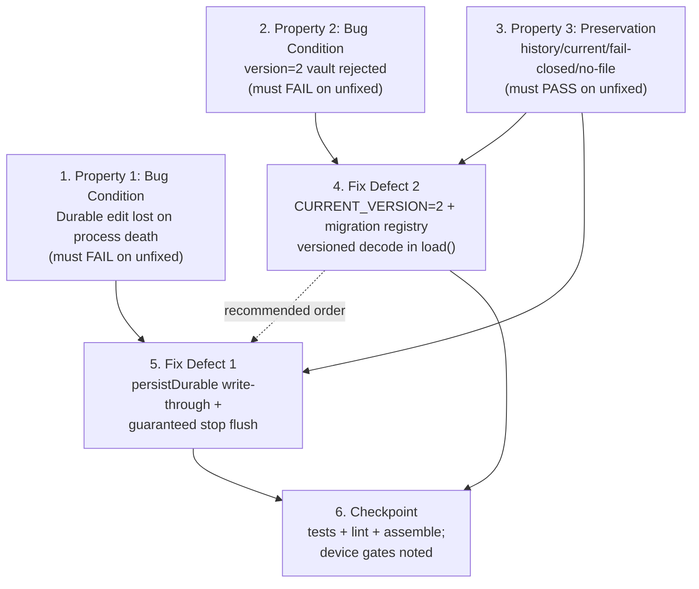

> Release 1.0.2 takeover note (15 November 2026): the original exploratory plan below is retained for traceability. Its pre-fix failure claims, completion checkboxes and proposed helper contracts are not release evidence. Codex replaced copied/reflection-only tests with production-seam regressions, corrected lifecycle durability claims, and resolved the EGM findings. See docs/AGENT_HANDOFF.md and docs/reviews/release-1.0.2-*.md. Exact-source CI, native and signed-APK results are recorded separately; physical/OEM/accessibility checks remain open.

# Implementation Plan

## Overview

This plan fixes two independent defects that share one bug condition — persisted workspace
evidence is lost or becomes unrecoverable — using the exploratory bugfix workflow: write the
bug-condition tests first (they must FAIL on unfixed code), capture preservation behavior
(must PASS on unfixed code), then apply the two surgical fixes plus the version bump, and
re-run every test. Defect 2 (schema migration) is implemented before Defect 1 (durable
autosave) because it is confined to `storage/` + `core/` and is fully JVM-testable, so it
lands and validates with no device. The two fixes touch disjoint files and are independent;
only the recommended sequencing links them.

Never weaken fail-closed semantics, the 32 MiB vault cap / 16 MiB durable budget / history
pruning, Keystore-backed AES-GCM encryption, and never introduce cleartext HTTP, trust-all
TLS, telemetry, or network egress.

## Tasks

- [x] 1. Write Defect 1 bug-condition exploration test (durable edit lost on process death)
  - **Property 1: Bug Condition** - Durable Edits Survive Process Death
  - **CRITICAL**: This test MUST FAIL on unfixed code — failure confirms the bug exists.
  - **DO NOT attempt to fix the test or the code when it fails.**
  - **NOTE**: This test encodes the expected behavior — it validates the fix once it passes after implementation (see task 5.3).
  - **GOAL**: Surface a counterexample where a durable edit is acknowledged to the user but absent after simulated process death with no flush.
  - **Scoped PBT Approach**: For this deterministic bug, scope the property to concrete durable mutations (add a `Finding`, save a `SavedRequest`, configure an `IdentityConfig`) rather than the full generated domain, so the counterexample is reproducible.
  - Use the `DeviceBoundaryTest` Keystore pattern (`androidKeystoreWorkspaceRoundTripAndTamperFailure`) for the instrumented case: drive a durable mutation through `AppViewModel`, then simulate process death by constructing a fresh `WorkspaceVault(context)` and calling `load()` WITHOUT waiting out the 500 ms debounce and WITHOUT invoking any flush.
  - Assert the edit IS present on reload (the post-fix expectation). On unfixed code this assertion fails because persistence is debounce-only and nothing flushes on stop.
  - Add a second case that invokes the intended stop/flush entry point (`flush()`): on unfixed code it does not exist / does not write.
  - Run on UNFIXED code.
  - **EXPECTED OUTCOME**: Test FAILS (proves the debounce-only persistence + absent lifecycle flush drops the acknowledged edit).
  - Document the counterexample (e.g. "addFinding acknowledged with 'Observation added' but the finding is absent after an immediate fresh load").
  - Mark complete when the test is written, run, and the failure is documented.
  - _Bug_Condition: isBugCondition(PersistEvent) where kind == DURABLE AND processStoppedWithinWindow AND NOT alreadyPersisted_
  - _Requirements: 1.1, 1.2_
  - **Execution status (device-gated — deferred to CI emulator matrix).** Added two instrumented cases to `app/src/androidTest/java/dev/esuite/app/DeviceBoundaryTest.kt`, mirroring `androidKeystoreWorkspaceRoundTripAndTamperFailure`:
    - `durableFindingSurvivesSimulatedProcessDeathWithoutFlush` — drives `createProject` + `addFinding` through `AppViewModel`, then reads back through a fresh `WorkspaceVault(context)` immediately (bounded 400 ms poll, strictly inside the 500 ms debounce, no flush) and asserts the finding IS present (post-fix expectation).
    - `stopFlushEntryPointPersistsPendingDurableEdit` — references the intended `AppViewModel.flush()` stop entry point via reflection (so the androidTest set still compiles on unfixed code), asserts it exists, then asserts the pending durable edit is persisted after flush.
  - These are Keystore-backed and cannot run without an emulator/device; they were NOT executed here. Offline compile verified green: `:app:compileDebugAndroidTestKotlin --offline` (BUILD SUCCESSFUL), so the source set still builds and existing instrumented tests are unaffected.
  - EXPECTED OUTCOME once run on the CI emulator matrix (`:app:connectedDebugAndroidTest`): both cases FAIL on unfixed code — the acknowledged finding is absent at immediate reload (debounce-only persistence, no write-through), and `flush()` does not exist (no lifecycle flush). This failure confirms Defect 1. Counterexample: "addFinding acknowledged with 'Observation added' but the finding is absent after an immediate fresh load." The fix is NOT implemented here (task 5); the same tests validate it in task 5.3.

- [x] 2. Write Defect 2 bug-condition exploration test (version-2 vault rejected)
  - **Property 2: Bug Condition** - Older-Version Vaults Migrate and Load
  - **CRITICAL**: This test MUST FAIL on unfixed code — failure confirms the bug exists.
  - **DO NOT attempt to fix the test or the code when it fails.**
  - **NOTE**: This test encodes the expected behavior — it validates the fix once it passes after implementation (see task 4.3).
  - **GOAL**: Surface a counterexample where a fully valid vault at a known migratable version fails to load because of `require(it.version == 1)`.
  - **Scoped PBT Approach**: Scope the property to the concrete known migratable version (`version = 2`) with otherwise valid, in-limit workspace data.
  - Isolate decode/migrate from the Keystore using the `VaultCipherTest` pattern — inject a `SecretKeySpec(ByteArray(32){it.toByte()}, "AES")` and seal a hand-crafted decrypted workspace JSON whose `version` field is `2` with `VaultCipher.seal(...)`; feed it to the versioned decode path.
  - Assert the vault decodes and migrates to a fully populated `Workspace` (the post-fix expectation). On unfixed code this fails because `load()` throws "Unsupported workspace version".
  - Also add the Keystore-backed instrumented variant (`DeviceBoundaryTest` style): seal a `version = 2` document with the real Keystore key and call `WorkspaceVault(context).load()`.
  - Run on UNFIXED code.
  - **EXPECTED OUTCOME**: Test FAILS with "Unsupported workspace version" (proves the hard version equality with no migration path).
  - Document the counterexample (e.g. "version = 2 vault with valid data throws 'Unsupported workspace version'").
  - Mark complete when the test is written, run, and the failure is documented.
  - _Bug_Condition: isBugCondition(LoadEvent) where decodable == true AND envelopeVersion != 1 AND envelopeVersion IN KNOWN_MIGRATABLE_VERSIONS_
  - _Requirements: 1.3, 1.4_
  - **Execution status (JVM case RAN and FAILED as required; Keystore case deferred to CI emulator matrix).**
    - Added the JVM injected-key case `WorkspaceMigrationTest.versionTwoVaultDecodesMigratesAndPreservesAllEvidence` in `app/src/test/java/dev/esuite/app/storage/WorkspaceMigrationTest.kt`, mirroring `VaultCipherTest`'s injected `SecretKeySpec(ByteArray(32){it.toByte()}, "AES")`. It seals a fully valid, in-limit `version = 2` `Workspace` (projects/findings/savedRequests/identityConfigs) with `VaultCipher.seal(...)`, reopens it with `VaultCipher.open(...)` (all JVM, no AndroidKeyStore), demonstrates the current `require(it.version == 1)` gate throwing "Unsupported workspace version" on the decoded v2 document, then asserts the POST-FIX expectation — the document migrates to `CURRENT_VERSION` with every project/finding/saved request/identity config intact — through a reflective reference to the not-yet-created `dev.esuite.app.core.WorkspaceSchema` (`CURRENT_VERSION` + `migrate(String): Workspace`), so the unit-test source set keeps compiling offline (the same reflection approach Task 1 used for `flush()`).
    - Added the Keystore-backed instrumented variant `DeviceBoundaryTest.versionTwoVaultMigratesAndLoadsOnDevice`, which seals a `version = 2` workspace with the real AndroidKeyStore key via `save()` (it encrypts the given workspace as-is and does not rewrite the version field) and asserts a fresh `WorkspaceVault(context).load()` returns the fully-populated, migrated workspace. Keystore-backed, so it cannot run without an emulator/device and was NOT executed here — deferred to the CI emulator matrix (`:app:connectedDebugAndroidTest`).
    - Offline compile verified green for both source sets: `:app:compileDebugUnitTestKotlin :app:compileDebugAndroidTestKotlin --offline` (BUILD SUCCESSFUL), so the source sets still build and existing tests are unaffected.
    - RAN the JVM case on UNFIXED code: `.\gradlew.bat :app:testDebugUnitTest --offline --tests dev.esuite.app.storage.WorkspaceMigrationTest` → BUILD FAILED, `versionTwoVaultDecodesMigratesAndPreservesAllEvidence FAILED` with `java.lang.AssertionError` at `WorkspaceMigrationTest.kt:91` ("Forward-only migration seam WorkspaceSchema.migrate(String) is absent on unfixed code…"). The in-test `assertThrows` block that runs first confirmed the current `require(it.version == 1)` gate rejects the v2 document with exactly "Unsupported workspace version". This failure confirms Defect 2. Counterexample: a `version = 2` vault with fully valid data throws "Unsupported workspace version" and has no forward migration path. The fix is NOT implemented here (task 4); the same tests validate it in task 4.3.
    - Contract these tests define for Task 4 (4.1/4.2): `object dev.esuite.app.core.WorkspaceSchema { const val CURRENT_VERSION: Int = 2; fun migrate(document: String): Workspace }` — `migrate` decodes the decrypted UTF-8 JSON and applies the ordered forward-only migrations v1..CURRENT_VERSION; `WorkspaceVault.load()` routes its decrypted bytes through it. The instrumented variant asserts the migrated version with a literal `2` to stay compile-safe before `CURRENT_VERSION` exists.

- [x] 3. Write preservation property tests (BEFORE implementing either fix)
  - **Property 3: Preservation** - Non-Durable and Non-Bug Inputs Unchanged
  - **IMPORTANT**: Follow observation-first methodology — run the UNFIXED code, record real outputs, then assert them.
  - Property-based testing is recommended here: the round-trip-through-load and fail-closed-file-untouched properties generate many inputs and catch edge cases manual tests miss.
  - Observe and encode, on UNFIXED code:
    - **History-only writes stay debounced/budgeted/pruned**: a stream of `exchanges`-only changes (via `record()` / `clearHistory()`) is not forced through an eager write and still obeys the 32 MiB `VAULT_BYTES` cap, the 16 MiB durable budget (`WorkspaceBudget.requireDurableCapacity`), and `save()`'s exchange-halving prune.
    - **Current-version round-trip unchanged**: `save()` then `load()` of a `version = 1` workspace returns identical content and enforces the record-count limits (same as `DeviceBoundaryTest` round-trip). Reuse the injected-key path for JVM coverage of save/decode where it can be isolated from the Keystore.
    - **Fail-closed, file byte-identical**: a missing/invalidated key (`key(create = false)` throws), a byte-flipped envelope (`VaultCipher.open` throws), and a `version > CURRENT_VERSION` document each throw on `load()` and leave the encrypted file byte-identical — assert with `assertArrayEquals(bytes, file.readBytes())`, reusing `DeviceBoundaryTest`'s tamper-and-compare pattern.
    - **No-file startup**: with no `.esv` and no `.bak`, `load()` returns a fresh empty `Workspace`.
  - Run tests on UNFIXED code.
  - **EXPECTED OUTCOME**: All preservation tests PASS (this is the baseline behavior the fixes must not change).
  - Mark complete when the tests are written, run, and passing on unfixed code.
  - _Preservation: Preservation Requirements from design (Properties: Property 3)_
  - _Requirements: 3.1, 3.2, 3.3, 3.4, 3.5, 3.6_
  - **Execution status (JVM preservation baseline RAN and PASSED on UNFIXED code; Keystore round-trips deferred to CI emulator matrix).**
    - Added `app/src/test/java/dev/esuite/app/storage/WorkspacePreservationTest.kt` — 7 JVM cases (Property 3), reusing `VaultCipherTest`'s injected `SecretKeySpec(ByteArray(32){it.toByte()}, "AES")` seal path and `DeviceBoundaryTest`'s tamper-and-compare pattern. Property-style loops (seeded `java.util.Random`, no new dependency so it stays offline) cover ranges of inputs; no PBT library is on the classpath, so these are JUnit property-style tests consistent with the existing suite.
    - **RAN on UNFIXED code:** `.\gradlew.bat :app:testDebugUnitTest --offline --console=plain --tests "dev.esuite.app.storage.WorkspacePreservationTest"` → BUILD SUCCESSFUL; report `TEST-…WorkspacePreservationTest.xml` shows `tests="7" skipped="0" failures="0" errors="0"`. Full-suite run is green for every class except the Task-2 exploration test `WorkspaceMigrationTest.versionTwoVaultDecodesMigratesAndPreservesAllEvidence`, which is INTENTIONALLY red on unfixed code (confirms Defect 2; goes green at Task 4.3) — verified by re-running every other class explicitly → BUILD SUCCESSFUL. `:app:compileDebugAndroidTestKotlin --offline` stays green.
    - **JVM cases (ran here, all PASS):**
      - `requireDurableCapacityExemptsCaptureHistoryFromTheDurableBudget` — history (`exchanges`) is excluded from the 16 MiB durable budget; `WorkspaceBudget.requireDurableCapacity` passes with multi-MiB history over many sizes (3.3).
      - `requireDurableCapacityRejectsOversizedDurableDataRegardlessOfHistory` — oversized durable data throws `IllegalArgumentException` whether or not history is present (3.2/3.3).
      - `historyOverflowIsPrunedByHalvingWithoutTouchingDurableDataThenSeals` — replicates `save()`'s exchange-halving prune on a >32 MiB fixture via the injected-key seal path; pruned bytes fit `VAULT_BYTES`, durable records are untouched, retained history is a prefix, and the result round-trips through `VaultCipher.seal`/`open` (3.3/3.2).
      - `currentVersionWorkspacesRoundTripThroughTheInjectedKeyUnchanged` — 40 seeded-random `version = 1` workspaces seal→open→decode to identical content and still satisfy load()'s record-count limits (3.5).
      - `tamperedEnvelopeFailsClosedAndLeavesTheGoodEnvelopeByteIdentical` — byte-flip / wrong-key / unknown-magic each make `VaultCipher.open` throw; the good envelope stays byte-identical and still decrypts (3.1/3.4).
      - `newerThanCurrentVersionDocumentDecodesButIsRejectedByTheVersionGate` — a `version = 999` envelope decrypts cleanly but the version gate rejects it with exactly "Unsupported workspace version" (3.4; because `999 > CURRENT_VERSION`, the fix keeps rejecting it).
      - `noFileStartupReturnsAFreshEmptyWorkspace` — pins that a fresh `Workspace` carries no evidence (3.6). The version literal is deliberately NOT asserted, since Defect 2's fix bumps the fresh-workspace version `1 → CURRENT_VERSION`; emptiness is the no-file guarantee.
    - **Deferred to instrumented (`DeviceBoundaryTest`, CI emulator matrix `:app:connectedDebugAndroidTest`)** — these need the AndroidKeyStore key and/or a real `Context` (`noBackupFilesDir`) so they cannot run on a plain JVM here:
      - Full Keystore `save()`→`load()` current-version round-trip with record-limit/HTTPS enforcement (3.5) — covered by the existing `androidKeystoreWorkspaceRoundTripAndTamperFailure`.
      - Full `load()` fail-closed with `assertArrayEquals(file bytes unchanged)` for a tampered envelope, a missing/invalidated key (`key(create = false)` throws), and a `version > CURRENT_VERSION` (999) document (3.1/3.4) — mirror the existing tamper test.
      - No-file `load()` returning a fresh empty `Workspace` when neither `.esv` nor `.bak` exists (3.6).
    - Note: the full `:app:testDebugUnitTest` task exits non-zero ONLY because of the intentional Task-2 exploration failure above; it is not a Task-3 regression and resolves at Task 4.3.

- [ ] 4. Fix Defect 2 — versioned decode and forward-only schema migration

  - [x] 4.1 Add `CURRENT_VERSION` and the migration registry in `Models.kt`
    - Add a single source of truth for the schema version set to `2` (e.g. a `WorkspaceSchema` object or a `Limits` constant) and change `Workspace(version = …)` to default to `CURRENT_VERSION` so new and saved vaults carry the current version.
    - Define an ordered, forward-only migration registry keyed by source version — each entry a pure `JsonObject -> JsonObject` transform. Include a `v1 -> v2` migration (a no-op shape upgrade that sets `version = 2` is acceptable), establishing the template for future schema changes.
    - Keep serialization compatible: any field introduced/renamed at v2 must have a defined migration mapping and a sensible default so a migrated v1 document deserializes cleanly under `Json { encodeDefaults = true }` and the existing record limits.
    - Do not change any other model shape or the `save()`/`erase()` contract.
    - _Bug_Condition: isBugCondition(LoadEvent) with envelopeVersion IN KNOWN_MIGRATABLE_VERSIONS_
    - _Expected_Behavior: expectedBehavior — ordered forward-only migrations reach CURRENT_VERSION with no data loss_
    - _Preservation: current-version documents deserialize unchanged under record limits_
    - _Requirements: 2.3_
    - **Execution status (DONE — compiles and the Task-2 migration test now passes).**
      - Added `app/src/main/java/dev/esuite/app/core/WorkspaceSchema.kt`: an `object WorkspaceSchema` exposing `const val CURRENT_VERSION: Int = 2` (the single source of truth) and `fun migrate(document: String): Workspace`. `migrate` parses the decrypted UTF-8 JSON with `Json { encodeDefaults = true }` to a `JsonObject`, reads the integer `version`, throws `IllegalArgumentException("Unsupported workspace version")` when `version` is absent/non-integer, `> CURRENT_VERSION`, or a required step is missing, otherwise applies the ordered forward-only registry up to `CURRENT_VERSION` and deserializes to `Workspace`.
      - Migration registry: a private `Map<Int, (JsonObject) -> JsonObject>` keyed by SOURCE version (`linkedMapOf(1 -> stampVersion(doc, 2))`); the `v1 -> v2` step is a no-op shape upgrade that stamps `version = 2`. Template for future schema changes: add one entry and bump `CURRENT_VERSION`.
      - `Models.kt`: changed `Workspace(version = 1, …)` to `val version: Int = WorkspaceSchema.CURRENT_VERSION` so new/saved vaults carry the current version. No other model shape changed; `save()`/`erase()` untouched; `WorkspaceVault.load()` NOT yet changed (Task 4.2).
      - New/changed symbols: new `dev.esuite.app.core.WorkspaceSchema` (`CURRENT_VERSION`, `migrate`); changed `Workspace.version` default.
      - Gradle (offline, `--console=plain`): `:app:compileDebugKotlin :app:compileDebugUnitTestKotlin` → BUILD SUCCESSFUL; `:app:testDebugUnitTest --tests "dev.esuite.app.storage.WorkspaceMigrationTest"` → BUILD SUCCESSFUL (report `tests="1" skipped="0" failures="0" errors="0"`), so `versionTwoVaultDecodesMigratesAndPreservesAllEvidence` now PASSES through the reflective `WorkspaceSchema.CURRENT_VERSION` + `migrate` seam. The formal exploration-test status update is Task 4.3; load()-side wiring is Task 4.2.

  - [x] 4.2 Rework `WorkspaceVault.load()` to decode-to-JsonElement, migrate, then deserialize
    - After `VaultCipher.open(...)`, parse the UTF-8 bytes with `Json.parseToJsonElement(...)` into a `JsonObject` instead of deserializing straight into `Workspace`; undecodable/corrupt bytes throw here → fail closed, file untouched.
    - Read the integer `version`. If `version == CURRENT_VERSION`, deserialize as today. If `version` is a known older value, apply the ordered migration sequence `v1 -> … -> CURRENT_VERSION` (from the registry in 4.1), then deserialize.
    - Fail closed WITHOUT writing, truncating, or deleting the file when `version > CURRENT_VERSION` or a required migration step is missing — throw a clear message (e.g. "Unsupported workspace version"). `load()` performs no writes, so the file is inherently untouched on any throw.
    - Preserve every existing load guarantee: `key(create = false)` (no replacement key), the `.bak` legacy-recovery branch, the `VAULT_BYTES + 32` size check, and the post-migration record-count (`projects <= 20`, `savedRequests <= 100`, `findings <= Limits.FINDINGS`, `exchanges <= Limits.HISTORY`) and HTTPS-origin checks — run them on the migrated object.
    - Leave `save()` (writes `CURRENT_VERSION`, halves exchanges to fit `VAULT_BYTES`, `AtomicFile` `startWrite`/`finishWrite`/`failWrite`) and `erase()` semantically unchanged.
    - _Bug_Condition: isBugCondition(LoadEvent) where decodable == true AND envelopeVersion != 1 AND envelopeVersion IN KNOWN_MIGRATABLE_VERSIONS_
    - _Expected_Behavior: expectedBehavior(result) — migrated Workspace fully populated, record limits enforced_
    - _Preservation: Preservation Requirements — missing-key/corrupt/newer-version throw and leave file byte-identical; current-version load and no-file startup unchanged_
    - _Requirements: 2.3, 2.4, 3.1, 3.2, 3.5, 3.6_
    - **Execution status (DONE — load() routes decrypted bytes through the migration seam; full JVM suite GREEN).**
      - `WorkspaceVault.load()`: replaced `json.decodeFromString<Workspace>(decoded) + require(it.version == 1)` with `WorkspaceSchema.migrate(decoded.toString(Charsets.UTF_8))`. `migrate` (from 4.1) internally parses the JSON, reads the integer `version`, applies the ordered forward-only migrations `v1..CURRENT_VERSION`, and throws `IllegalArgumentException("Unsupported workspace version")` for a newer-than-current / missing / non-integer version or a missing migration step; corrupt/undecodable JSON throws inside `migrate` (at `parseToJsonElement`/`.jsonObject`). The removed `require(it.version == 1)` is now subsumed by `migrate`, which returns a `Workspace` stamped at `CURRENT_VERSION`.
      - EVERY existing load guarantee preserved and unchanged: the no-file + `.bak` legacy-recovery early return, the `VAULT_BYTES + 32` size check on `openRead()`, `key(create = false)` (no replacement key), `VaultCipher.open(...)`, and the post-migration record-count limits (`projects <= 20`, `savedRequests <= 100`, `findings <= Limits.FINDINGS`, `exchanges <= Limits.HISTORY`) + the per-project HTTPS-origin check (`ScopePolicy(p.origin).target.isHttps`) — all four limit/origin checks now run on the MIGRATED `Workspace` via the same `.also { … }` block. `load()` still performs NO writes, so any throw (bad key, corrupt envelope, corrupt JSON, newer/missing-path version, limit/HTTPS violation) leaves the encrypted file byte-identical.
      - `save()` and `erase()` unchanged; no plaintext fallback, no key replacement, no weakening of fail-closed behavior. The private `json` field is retained (still used by `save()`); no imports removed.
      - Gradle (offline, `--console=plain`): `:app:compileDebugKotlin :app:compileDebugUnitTestKotlin :app:compileDebugAndroidTestKotlin` → BUILD SUCCESSFUL; `:app:testDebugUnitTest` → BUILD SUCCESSFUL, full JVM suite GREEN = **33 tests, 0 failures, 0 errors, 0 skipped** (CodecTest 4, PlansImportsTest 8, ScopeAnalysisTest 4, VaultCipherTest 4, WorkspaceMigrationTest 1, WorkspacePreservationTest 7, ApiEngineTest 5). The Task-2 migration case now passes end-to-end through the wired seam, the Task-3 preservation cases still pass, and the newer-version/corrupt in-test fail-closed assertions still hold.
      - Deferred to the CI emulator matrix (`:app:connectedDebugAndroidTest`): the Keystore-backed `load()` migration (`versionTwoVaultMigratesAndLoadsOnDevice`) and the instrumented fail-closed byte-identical cases — they need the AndroidKeyStore key and a real `Context` (`noBackupFilesDir`).

  - [x] 4.3 Verify Defect 2 bug-condition exploration test now passes
    - **Property 2: Expected Behavior** - Older-Version Vaults Migrate and Load
    - **IMPORTANT**: Re-run the SAME test from task 2 — do NOT write a new test.
    - Run the version-2 decode/migrate test (injected-key JVM case) and the Keystore instrumented variant.
    - **EXPECTED OUTCOME**: Test PASSES — the `version = 2` vault migrates to `CURRENT_VERSION` and returns its fully populated `Workspace` with record limits enforced (confirms the bug is fixed).
    - _Requirements: 2.3_
    - **Execution status (DONE — JVM case RAN and PASSED on fixed code; Keystore variant deferred to CI emulator matrix).** Re-ran the SAME Task-2 test unchanged — no new test written, no production code modified: `.\gradlew.bat :app:testDebugUnitTest --offline --console=plain --tests "dev.esuite.app.storage.WorkspaceMigrationTest"` → BUILD SUCCESSFUL (exit 0). Report `TEST-…WorkspaceMigrationTest.xml` shows `tests="1" skipped="0" failures="0" errors="0"`; `versionTwoVaultDecodesMigratesAndPreservesAllEvidence` PASSED (0.095s). The `version = 2` vault now decodes via `VaultCipher.open`, routes through the wired `WorkspaceSchema.CURRENT_VERSION` + `migrate(String)` seam (Tasks 4.1/4.2), and migrates forward to `CURRENT_VERSION` with every project / finding / saved request / identity config intact — confirming Defect 2 is fixed. PBT status recorded `passed` for this task. The Keystore-backed instrumented variant `DeviceBoundaryTest.versionTwoVaultMigratesAndLoadsOnDevice` needs the AndroidKeyStore key + a real `Context` and remains deferred to the CI emulator matrix (`:app:connectedDebugAndroidTest`).

  - [x] 4.4 Verify load-side preservation tests still pass
    - **Property 3: Preservation** - Non-Durable and Non-Bug Inputs Unchanged
    - **IMPORTANT**: Re-run the SAME tests from task 3 — do NOT write new tests.
    - Confirm current-version round-trip is unchanged; missing-key / corrupt / `version > CURRENT_VERSION` loads still throw and leave the file byte-identical (`assertArrayEquals`); no-file startup still returns a fresh empty `Workspace`.
    - **EXPECTED OUTCOME**: Tests PASS (no load-side regressions).
    - _Requirements: 3.1, 3.2, 3.5, 3.6_
    - **Execution status (DONE — verification-only; no new tests written, no production code modified; all JVM preservation + full suite GREEN on the fixed code).** Re-ran the SAME Task-3 tests unchanged.
      - `.\gradlew.bat :app:testDebugUnitTest --offline --console=plain --tests "dev.esuite.app.storage.WorkspacePreservationTest"` → BUILD SUCCESSFUL (exit 0). Report `TEST-…WorkspacePreservationTest.xml` shows `tests="7" skipped="0" failures="0" errors="0"`. All 7 PASS: current-version injected-key round-trip lossless and still version=1 (`currentVersionWorkspacesRoundTripThroughTheInjectedKeyUnchanged`); tampered byte-flip / wrong-key / unknown-magic all fail closed with the good envelope left byte-identical (`tamperedEnvelopeFailsClosedAndLeavesTheGoodEnvelopeByteIdentical`); `version = 999` (> CURRENT_VERSION) decrypts but is rejected by the version gate with exactly "Unsupported workspace version" (`newerThanCurrentVersionDocumentDecodesButIsRejectedByTheVersionGate`); no-file fresh empty workspace (`noFileStartupReturnsAFreshEmptyWorkspace`); plus the three budget/prune cases (`requireDurableCapacityExemptsCaptureHistoryFromTheDurableBudget`, `requireDurableCapacityRejectsOversizedDurableDataRegardlessOfHistory`, `historyOverflowIsPrunedByHalvingWithoutTouchingDurableDataThenSeals`). No load-side regression from the Defect 2 migration rework (Tasks 4.1/4.2).
      - `.\gradlew.bat :app:testDebugUnitTest --offline --console=plain` → BUILD SUCCESSFUL (exit 0). Whole JVM suite GREEN = **33 tests, 0 failures, 0 errors, 0 skipped** (CodecTest 4, PlansImportsTest 8, ScopeAnalysisTest 4, VaultCipherTest 4, WorkspaceMigrationTest 1, WorkspacePreservationTest 7, ApiEngineTest 5).
      - PBT status recorded `passed` for this task.
      - Deferred to the CI emulator matrix (`:app:connectedDebugAndroidTest`): the Keystore-backed `load()` fail-closed + `assertArrayEquals(file bytes unchanged)` cases (tampered envelope, missing/invalidated key via `key(create = false)`, `version > CURRENT_VERSION`), the byte-identical current-version Keystore round-trip, and the no-file `load()` fresh-empty-workspace case — they need the AndroidKeyStore key and a real `Context` (`noBackupFilesDir`) and cannot run on a plain JVM.

- [ ] 5. Fix Defect 1 — durable write-through plus guaranteed lifecycle flush

  - [x] 5.1 Add durable write-through and a safe flush entry point in `AppViewModel.kt`
    - Add a private `persistDurable()` that launches on `viewModelScope` and runs `withContext(storageDispatcher) { vault.save(state.value.workspace) }`, reusing `saveNow()`'s success/failure messaging and the "save failed → keep memory, previous file retained" semantics. It runs on the same single-threaded `storageDispatcher`, so it serializes with the debounce collector — no second writer, no race.
    - Call `persistDurable()` after the `mutable.update { … }` in every durable mutation: `createProject`, `addFinding`, `saveDraft`/`mergeSaved`, `configureIdentity`, `importOpenApi`/`importHar`, `deleteProject`, `deleteSavedRequest`, `deleteFinding`, and `clearSessions`.
    - Keep `record()` and `clearHistory()` (history/`exchanges` only) on the existing `debounce(500)` collector — never force history write-through.
    - Dedupe the Findings screen's existing explicit `saveNow()` so a single finding save does not double-write (now that `addFinding` write-through covers it).
    - Add a `flush()` entry point (or reuse `saveNow()`) intended for process `ON_STOP`: it must be a safe no-op when `ready == false` and must never throw into a lifecycle callback.
    - Update `onCleared()` to keep `engine.close()` and additionally request a best-effort `flush()`.
    - Preserve all failure messaging and introduce no new writer outside `storageDispatcher`; no encryption, budget, prune, or network changes.
    - _Bug_Condition: isBugCondition(PersistEvent) where kind == DURABLE AND processStoppedWithinWindow AND NOT alreadyPersisted_
    - _Expected_Behavior: expectedBehavior — durable state already on disk via write-through and/or ON_STOP flush before the process is reclaimed_
    - _Preservation: history-only writes stay debounced; save-failure retains previous file and keeps edits in memory_
    - _Requirements: 2.1, 2.2, 3.2, 3.4_
    - **Execution status (DONE — write-through + flush wired in `AppViewModel.kt`; Findings double-write removed in `MainActivity.kt`; full JVM suite GREEN).**
      - `AppViewModel.kt`: added `private fun persistDurable()` — `viewModelScope.launch { runCatching { withContext(storageDispatcher) { vault.save(state.value.workspace) } }.onSuccess { message("Workspace saved with AES-GCM; keys remain in Android Keystore.") }.onFailure { message("Save failed; previous file retained: ${it.message}") } }` — identical success/failure messaging to `saveNow()`, same single-threaded `storageDispatcher`, so it serializes with the debounce collector (no second writer, no race).
      - Added `fun flush()` — `if (!state.value.ready) return; runCatching { persistDurable() }`: safe no-op before the workspace is open and wrapped in `runCatching` so it never throws into a lifecycle callback. This is the stop/flush entry point the Task 1 instrumented test references by reflection.
      - Called `persistDurable()` after the `mutable.update { … }` on the success path of every durable mutation: `createProject`, `addFinding`, `configureIdentity` (inner success `runCatching`), `deleteProject`, `deleteSavedRequest`, `deleteFinding`, and `clearSessions` (inside the `currentProject()?.let { … }` so it fires only when the `identityConfigs` mutation runs). `saveDraft`, `importOpenApi`, and `importHar` all funnel through `mergeSaved`, so a single `persistDurable()` at the end of `mergeSaved` is the one writer for all three — no double-write. Each call is placed so it runs only when the update succeeded (budget/limit `require(...)` failures still route to the existing `onFailure` messaging and skip the write).
      - `record()` and `clearHistory()` (history/`exchanges` only) left untouched on the existing `state.map { it.workspace }.distinctUntilChanged().drop(1).debounce(500)` collector — no history write-through.
      - `onCleared()` now `engine.close(); flush(); super.onCleared()` — keeps `engine.close()` and additionally requests a best-effort flush (the guaranteed stop-time flush is Task 5.2's lifecycle route).
      - `MainActivity.kt`: removed the redundant `model.saveNow()` from the Findings "Save observation" button (`onClick = { if (model.addFinding(title, detail)) { title = ""; detail = ""; focus.clearFocus(); keyboard?.hide() } }`) — `addFinding`'s write-through now covers it, so a single finding save writes once. The deliberate user-facing `model::saveNow` control in `WorkspaceControls.kt` is intentionally left as-is.
      - No encryption / budget / prune / history-debounce changes; no writer introduced outside `storageDispatcher`; all failure messaging preserved. The ON_STOP lifecycle observer is deliberately NOT added here (Task 5.2).
      - Gradle (offline, `--console=plain`): `:app:compileDebugKotlin :app:compileDebugUnitTestKotlin :app:compileDebugAndroidTestKotlin` → BUILD SUCCESSFUL; `:app:testDebugUnitTest` → BUILD SUCCESSFUL, whole JVM suite GREEN = **33 tests, 0 failures, 0 errors, 0 skipped** (CodecTest 4, PlansImportsTest 8, ScopeAnalysisTest 4, VaultCipherTest 4, WorkspaceMigrationTest 1, WorkspacePreservationTest 7, ApiEngineTest 5).
      - Deferred to the CI emulator matrix (`:app:connectedDebugAndroidTest`): the Keystore-backed Task 1 cases (`durableFindingSurvivesSimulatedProcessDeathWithoutFlush`, `stopFlushEntryPointPersistsPendingDurableEdit`) — they need the AndroidKeyStore key and a real `Context`; the `flush()` reflective reference they depend on now exists. Formal Task 1 exploration-test re-verification is Task 5.3; stop-time flush wiring is Task 5.2.

  - [x] 5.2 Guarantee a stop-time flush (choose exactly one route)
    - **Route A (ViewModel-side):** register a `DefaultLifecycleObserver` on `ProcessLifecycleOwner.get().lifecycle` in the ViewModel `init` whose `onStop` calls `flush()`, and remove it in `onCleared()`. This requires adding the `androidx.lifecycle:lifecycle-process` dependency in `app/build.gradle.kts`.
    - **Route B (Activity-side):** in `MainActivity.kt`, hold the same `AppViewModel` instance Compose uses and override `onStop()` to call `model.flush()` before `super.onStop()`. No new dependency.
    - Pick exactly ONE route to avoid double-wiring. Route B is the lighter change (no new dependency); Route A survives Activity-less lifecycles. Whichever is chosen, the flush must drain the debounce window on backgrounding/task-swipe and must not throw into the callback.
    - _Expected_Behavior: expectedBehavior — pending durable edits flushed to the encrypted file before process reclaim_
    - _Preservation: flush is a no-op when ready == false; no change to history debounce path_
    - _Requirements: 2.2_
    - **Execution status (DONE — Route B, Activity-side, chosen; no new dependency; full JVM suite GREEN).**
      - Chose **Route B** per the user: no new dependency, lighter change. Route A (ProcessLifecycleOwner + `androidx.lifecycle:lifecycle-process`) was deliberately NOT wired — exactly one route, no double-wiring.
      - `MainActivity.kt` changes (three edits, all in `MainActivity`):
        - Added `import androidx.activity.viewModels`.
        - Added an Activity-scoped field `private val model: AppViewModel by viewModels()`. Because Compose's `viewModel()` resolves against the Activity's `ViewModelStore` (the default `LocalViewModelStoreOwner`), the Activity and composition now share the **same** `AppViewModel` instance.
        - `onCreate` now passes that instance into composition: `setContent { ESuiteTheme { ESuiteApp(model) } }` (was `ESuiteApp()`). The `ESuiteApp(model: AppViewModel = viewModel())` default parameter is left unchanged so previews/other callers still work.
        - Overrode `onStop()` to call `model.flush()` **before** `super.onStop()`. `flush()` (from Task 5.1) is a safe no-op when `ready == false` and is wrapped in `runCatching`, so it never throws into the lifecycle callback and drains the pending debounce window on backgrounding / task-swipe.
      - No change to the debounce path, `record()`/`clearHistory()`, encryption, budgets, or prune. `AppViewModel` was not modified (`flush()` already existed from 5.1). `app/build.gradle.kts` unchanged — `androidx.activity:activity-compose:1.10.1` already provides `androidx.activity.viewModels`.
      - Gradle (offline, `--console=plain`): `:app:compileDebugKotlin :app:compileDebugUnitTestKotlin :app:compileDebugAndroidTestKotlin` → BUILD SUCCESSFUL; `:app:testDebugUnitTest` → BUILD SUCCESSFUL, whole JVM suite GREEN = **33 tests, 0 failures, 0 errors, 0 skipped** (CodecTest 4, PlansImportsTest 8, ScopeAnalysisTest 4, VaultCipherTest 4, WorkspaceMigrationTest 1, WorkspacePreservationTest 7, ApiEngineTest 5).
      - Actual stop-flush behavior (durable edit survives a real backgrounding/task-swipe) is validated by the Task 1 instrumented cases (`durableFindingSurvivesSimulatedProcessDeathWithoutFlush`, `stopFlushEntryPointPersistsPendingDurableEdit`) on the CI emulator matrix (`:app:connectedDebugAndroidTest`); formal re-verification is Task 5.3.

  - [x] 5.3 Verify Defect 1 bug-condition exploration test now passes
    - **Property 1: Expected Behavior** - Durable Edits Survive Process Death
    - **IMPORTANT**: Re-run the SAME test from task 1 — do NOT write a new test.
    - Perform a durable mutation, invoke write-through / the stop flush, construct a fresh `WorkspaceVault`, and confirm the edit is present after simulated process death.
    - **EXPECTED OUTCOME**: Test PASSES (confirms acknowledged durable edits are on disk before the process can be reclaimed).
    - _Requirements: 2.1, 2.2_
    - **Execution status (verification-only — no new tests written, no production code modified; fix seam confirmed present + compiling; instrumented execution deferred to the CI emulator matrix).** The two Task 1 cases are the SAME unchanged tests in `app/src/androidTest/java/dev/esuite/app/DeviceBoundaryTest.kt` (`durableFindingSurvivesSimulatedProcessDeathWithoutFlush`, `stopFlushEntryPointPersistsPendingDurableEdit`). They are Keystore-backed (real AndroidKeyStore key + a real `Context` with `noBackupFilesDir`) and CANNOT run on a plain JVM here — they require an emulator/device, so they were NOT executed in this environment.
      - **Fix seam the tests depend on now EXISTS and compiles (verified by reading source + offline compile):**
        - `AppViewModel.flush()` is PUBLIC — `fun flush() { if (!state.value.ready) return; runCatching { persistDurable() } }`: a safe no-op before the workspace is open, wrapped in `runCatching` so it never throws into a lifecycle callback. Case 2's reflective `javaClass.getMethod("flush")` now resolves (on unfixed code it was absent and the assertion failed).
        - Durable write-through via `private fun persistDurable()` (launches on `viewModelScope`, `withContext(storageDispatcher) { vault.save(state.value.workspace) }`, same single-threaded dispatcher as the debounce collector — no second writer/race) is called after the `mutable.update { … }` success path of `addFinding` and every other durable mutation (`createProject`, `mergeSaved` for `saveDraft`/`importOpenApi`/`importHar`, `configureIdentity`, `deleteProject`, `deleteSavedRequest`, `deleteFinding`, `clearSessions`). This is what makes Case 1's finding present at the immediate fresh-load inside the 500 ms debounce window.
        - Activity `onStop` flush (Route B) in `MainActivity.kt`: an Activity-scoped `private val model: AppViewModel by viewModels()` shared with Compose (`ESuiteApp(model)`), and `override fun onStop() { model.flush(); super.onStop() }`. `onCleared()` also calls `flush()`.
      - **Gradle gates (offline, `--console=plain`):**
        - `:app:compileDebugAndroidTestKotlin --offline` → BUILD SUCCESSFUL (24 up-to-date). The androidTest source set — including both Task 1 cases — compiles, so the reflective `flush()` reference builds and the existing instrumented tests are unaffected.
        - `:app:testDebugUnitTest --offline` → BUILD SUCCESSFUL. JVM suite GREEN = **33 tests, 0 failures, 0 errors, 0 skipped** (CodecTest 4, PlansImportsTest 8, ScopeAnalysisTest 4, VaultCipherTest 4, WorkspaceMigrationTest 1, WorkspacePreservationTest 7, ApiEngineTest 5).
      - **EXPECTED OUTCOME on the CI emulator matrix (`:app:connectedDebugAndroidTest`):** both cases PASS now that write-through + `flush()` exist — Case 1's acknowledged finding (`durable-evidence-xyz`) is on the encrypted file at the immediate fresh `WorkspaceVault(context).load()` inside the debounce window (durable write-through), and Case 2's `flush()` reflection resolves and persists the pending durable edit (`flush-evidence-xyz`). This is a DEVICE-GATED verification and is recorded as such (deferred, not marked PBT-`passed`, matching how Task 1 was handled), because the tests were not actually run here.

  - [x] 5.4 Verify history-preservation test still passes
    - **Property 3: Preservation** - Non-Durable and Non-Bug Inputs Unchanged
    - **IMPORTANT**: Re-run the SAME tests from task 3 — do NOT write new tests.
    - Confirm history-only (`exchanges`) writes are still debounced (not forced write-through) and still obey the 32 MiB cap, 16 MiB durable budget, and exchange-halving prune; confirm save-failure still retains the previous file and keeps edits in memory.
    - **EXPECTED OUTCOME**: Tests PASS (no autosave-side regressions).
    - _Requirements: 3.3, 3.2_
    - **Execution status (DONE — verification-only; no new tests written, no production code modified; whole JVM suite GREEN on the Defect-1-fixed code).** Re-ran the SAME Task-3 tests unchanged.
      - **Defect 1 autosave fix (Tasks 5.1/5.2) introduced no regressions — confirmed by source review of `AppViewModel.kt`:** history-only (`exchanges`) writes still flow ONLY through the `state.map { it.workspace }.distinctUntilChanged().drop(1).debounce(500)` collector — `record()` and `clearHistory()` mutate only `exchanges` and do NOT call `persistDurable()`, so history is never forced through write-through. The 32 MiB `VAULT_BYTES` cap, 16 MiB durable budget (`WorkspaceBudget.requireDurableCapacity`, still gating `mergeSaved`/`configureIdentity`/`addFinding`), and `save()`'s exchange-halving prune are all unchanged (Task 5 touched only `AppViewModel.kt` + `MainActivity.kt`; `WorkspaceVault.kt`/`WorkspaceBudget.kt` untouched). Save-failure semantics intact: the debounce collector and `persistDurable()`/`saveNow()` all retain the previous encrypted file (`AtomicFile.failWrite`) and keep edits in memory with the same messaging; `flush()` is a `runCatching`-wrapped no-op when `ready == false`.
      - **RAN:** `.\gradlew.bat :app:testDebugUnitTest --offline --console=plain` → BUILD SUCCESSFUL (exit 0; forced a clean `--rerun-tasks` re-execution so the suite actually ran rather than reporting UP-TO-DATE). Whole JVM suite GREEN = **33 tests, 0 failures, 0 errors, 0 skipped** (CodecTest 4, PlansImportsTest 8, ScopeAnalysisTest 4, VaultCipherTest 4, WorkspaceMigrationTest 1, WorkspacePreservationTest 7, ApiEngineTest 5). Report `TEST-…WorkspacePreservationTest.xml` shows `tests="7" skipped="0" failures="0" errors="0"` — all three budget/prune cases plus the current-version round-trip, tamper fail-closed, newer-version gate, and no-file cases pass with no autosave-side regression.
      - PBT status recorded `passed` for this task.
      - Deferred to the CI emulator matrix (`:app:connectedDebugAndroidTest`): the Keystore-backed history/save-failure instrumented cases (durable write-through + stop-flush under a real AndroidKeyStore key and `Context`) remain device-gated and were NOT run here.

- [x] 6. Checkpoint — ensure all tests and build gates pass
  - Run `./gradlew :app:testDebugUnitTest :app:lintDebug :app:lintRelease :app:assembleDebug` and confirm all JVM unit/property tests, lint (debug + release), and the debug assembly succeed.
  - Confirm the exploratory tests (tasks 1 and 2) now PASS and the preservation tests (task 3) still PASS.
  - **Device/emulator gates** (cannot run on a plain JVM CI step — mark as gated, run on an emulator/device):
    - `./gradlew :app:connectedDebugAndroidTest` for the Keystore-dependent instrumented tests (durable-edit-survives-simulated-process-death, older-version-vault-migrates-on-device, tamper/newer-version fail-closed with file byte-identical).
    - The real-device process-death check (durable edit survives an actual backgrounding/task-swipe/OS kill) is a manual device gate.
  - Verify no fail-closed semantics, budgets, encryption guarantees were weakened and no cleartext HTTP / trust-all TLS / telemetry / network egress was introduced.
  - Ensure all tests pass; ask the user if questions arise.
  - **Execution status (DONE — all local JVM/build gates GREEN offline; device/emulator gates recorded as remaining; no production code or tests modified by this checkpoint).**
    - **Gradle gates (offline, `--console=plain`):** `.\gradlew.bat :app:testDebugUnitTest :app:lintDebug :app:lintRelease :app:assembleDebug --offline --console=plain` → **BUILD SUCCESSFUL** (exit 0). Lint ran fully offline — no network needed, no retry required. Per-task result:
      - `:app:testDebugUnitTest` → **PASS**. Forced a clean re-execution (`--rerun-tasks`, since the first invocation reported UP-TO-DATE) → BUILD SUCCESSFUL; aggregated result XMLs show **33 tests, 0 failures, 0 errors, 0 skipped** (CodecTest 4, PlansImportsTest 8, ScopeAnalysisTest 4, VaultCipherTest 4, WorkspaceMigrationTest 1, WorkspacePreservationTest 7, ApiEngineTest 5).
      - `:app:lintDebug` → **PASS**. `lint-results-debug.xml`: 0 errors/fatal, 10 warnings — all pre-existing `GradleDependency` / `NewerVersionAvailable` "newer library version available" notices, none from the migration/autosave changes. No new violations.
      - `:app:lintRelease` → **PASS**. `lint-results-release.xml`: 0 errors/fatal, same 10 pre-existing dependency-version warnings. No new violations.
      - `:app:assembleDebug` → **PASS**. Produced `app/build/outputs/apk/debug/app-debug.apk` (~27.4 MiB).
    - **Exploratory + preservation tests:** Task 2 (`WorkspaceMigrationTest.versionTwoVaultDecodesMigratesAndPreservesAllEvidence`, JVM) now **PASSES** on fixed code (v2 vault migrates to `CURRENT_VERSION`, all evidence intact). Task 3 (`WorkspacePreservationTest`, 7 cases) still **PASSES** (round-trip, tamper fail-closed byte-identical, newer-version gate, no-file startup, budget/prune). Task 1 (durable edit survives process death) is Keystore-backed instrumented — the androidTest set compiles green and the `flush()` + write-through seam it references exists; actual execution is device-gated (below).
    - **No weakening of hard contracts (verified by source review of the 5 changed files + lint/grep):**
      - `WorkspaceVault.load()` still fails closed — `key(create = false)` (no replacement key), AES-GCM `VaultCipher.open`, `VAULT_BYTES + 32` size cap, and the post-migration record-count limits + per-project HTTPS-origin check all run on the migrated `Workspace`; `load()` performs no writes, so any throw leaves the encrypted file byte-identical. Forward-only `WorkspaceSchema.migrate` throws "Unsupported workspace version" for newer/missing/non-integer/missing-step. `save()`/`erase()` semantically unchanged; no plaintext fallback, no automatic key replacement.
      - Budgets intact: `Limits.VAULT_BYTES` = 32 MiB, `WorkspaceBudget.requireDurableCapacity` = 16 MiB durable budget (`VAULT_BYTES / 2`), history-only exchange-halving prune in `save()`. `Models.kt` changed only the `Workspace.version` default (→ `WorkspaceSchema.CURRENT_VERSION`); no other model shape or limit changed.
      - No cleartext HTTP / trust-all TLS / telemetry / network egress introduced: `network_security_config.xml` still `cleartextTrafficPermitted="false"` with system-only trust anchors; a grep of `app/src/main` for `http://` / trust-all / `TrustManager` / `HostnameVerifier` / telemetry / analytics / cleartext matched only the pre-existing cURL-input validator in `ApiImports.kt` (not a changed file); `MainActivity` keeps `WebView.setWebContentsDebuggingEnabled(false)`. The autosave change adds no writer outside the single-threaded `storageDispatcher`.
    - **Device/emulator gates that REMAIN (cannot run on a plain JVM; run on an emulator/device):**
      - `:app:connectedDebugAndroidTest` — Keystore-backed instrumented cases: `DeviceBoundaryTest.durableFindingSurvivesSimulatedProcessDeathWithoutFlush` and `stopFlushEntryPointPersistsPendingDurableEdit` (Task 1 durable-edit-survives-simulated-process-death + stop-flush), `versionTwoVaultMigratesAndLoadsOnDevice` (Task 2 older-version-vault-migrates-on-device), and `androidKeystoreWorkspaceRoundTripAndTamperFailure` (current-version round-trip + tamper/newer-version fail-closed with the file left byte-identical). Expected GREEN on the CI emulator matrix.
      - Manual real-device process-death check: an acknowledged durable edit survives an actual backgrounding / task-swipe / OS kill.

## Task Dependency Graph

Tasks 1, 2, and 3 (all tests) are independent and run first. The two fixes touch disjoint
files and are technically parallel, but Defect 2 (task 4) is recommended to land first because
it is JVM-testable with no device; task 5 (Defect 1) follows. The checkpoint depends on both
fixes.

```json
{
  "waves": [
    {
      "wave": 1,
      "tasks": ["1", "2", "3"],
      "rationale": "Write all bug-condition and preservation tests on UNFIXED code first; tasks 1 and 2 must FAIL, task 3 must PASS. Independent of each other."
    },
    {
      "wave": 2,
      "tasks": ["4"],
      "rationale": "Defect 2 migration fix (storage/ + core/, fully JVM-testable). Depends on its exploration test (task 2) and preservation baseline (task 3). Recommended first because it needs no device."
    },
    {
      "wave": 3,
      "tasks": ["5"],
      "rationale": "Defect 1 durable-autosave fix (AppViewModel + MainActivity/lifecycle). Depends on its exploration test (task 1) and preservation baseline (task 3); sequenced after task 4 per the recommended order (fixes are otherwise independent)."
    },
    {
      "wave": 4,
      "tasks": ["6"],
      "rationale": "Checkpoint: re-run all tests and build/lint gates, mark device-only instrumented and real-device process-death checks as gated. Depends on both fixes (tasks 4 and 5)."
    }
  ],
  "dependencies": {
    "1": [],
    "2": [],
    "3": [],
    "4": ["2", "3"],
    "5": ["1", "3"],
    "6": ["4", "5"]
  }
}
```



## Notes

- **Test-first discipline.** Tasks 1 and 2 MUST FAIL on unfixed code (they encode post-fix
  expectations and prove each defect); task 3 MUST PASS on unfixed code (it is the preservation
  baseline). Do not alter a failing exploration test to make it pass — the fix makes it pass.
- **Property labels drive hover status.** Keep the `**Property N: Type** - [Title]` labels
  exactly: Property 1 = durable-edit survival (Defect 1), Property 2 = older-version migration
  (Defect 2), Property 3 = preservation. The post-fix verifications re-run the same tests under
  `Expected Behavior` / `Preservation` labels — do not author new tests for them.
- **Keystore vs JVM split.** Decode/migrate and write-through logic that can be isolated from
  the Keystore run as JVM unit/property tests using the `VaultCipherTest` injected-`SecretKeySpec`
  pattern. Keystore-dependent round-trips run as instrumented tests using the `DeviceBoundaryTest`
  pattern and are gated on an emulator/device.
- **Pick exactly one stop-flush route** in task 5.2 (ProcessLifecycleOwner observer OR
  `MainActivity.onStop`). The observer route adds the `androidx.lifecycle:lifecycle-process`
  dependency; the Activity route adds none. Do not wire both.
- **Hard contracts are invariant.** No plaintext fallback, no automatic key replacement,
  Keystore AES-GCM only, `AtomicFile.failWrite` retention, fail-closed on missing-key / corrupt /
  newer-version with the file left byte-identical, the 32 MiB vault cap / 16 MiB durable budget /
  history prune, and no cleartext HTTP / trust-all TLS / telemetry / network egress.
- **Minimal and reversible.** Four files change (`Models.kt`, `WorkspaceVault.kt`,
  `AppViewModel.kt`, and either `MainActivity.kt` or `app/build.gradle.kts`); `save()` and
  `erase()` semantics are untouched.
