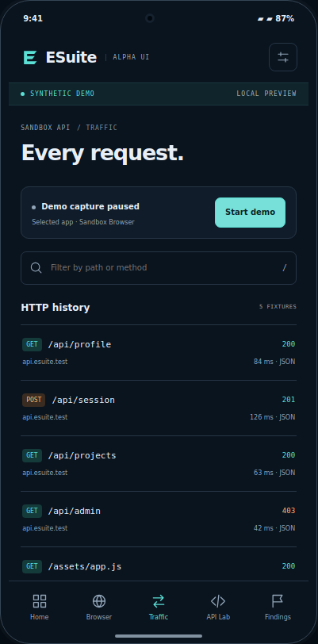
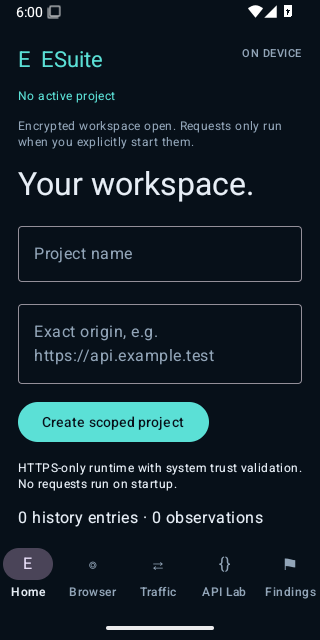
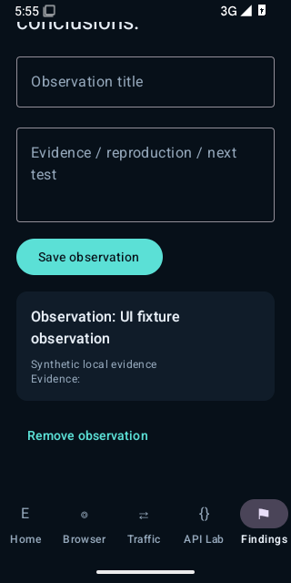

<p align="center"></p>

<h1 align="center">ESuite</h1>
<p align="center"><strong>Inspect. Replay. Investigate.</strong><br>An on-device web and API security workbench for Android.</p>

<p align="center"><a href="#try-esuite">Get started</a> · <a href="docs/UI_SPEC.md">UI & design</a> · <a href="docs/ROADMAP.md">Roadmap</a> · <a href="docs/PRODUCT_PLAN.md">Full specification</a> · <a href="CONTRIBUTING.md">Contribute</a></p>

<p align="center"><a href="https://github.com/modhack2003/Esuite/actions/workflows/ci.yml"></a></p>


<p align="center"><strong><a href="https://github.com/modhack2003/Esuite/releases/download/v1.0.2/ESuite-1.0.2.apk">Download ESuite 1.0.2 APK</a></strong> · Android 9–17 · Signed and optimized</p>

<p align="center"><strong>Native Android</strong> &nbsp; / &nbsp; <strong>No root required</strong> &nbsp; / &nbsp; <strong>No computer during use</strong> &nbsp; / &nbsp; <strong>Local processing</strong></p>

> **Available now: native web/API workbench.** API Lab now executes scoped HTTP requests with separate identity cookie jars; the native browser implements local page inspection, cookie tools, console and storage views on compatible WebViews. Browser history currently contains **request metadata only**, without response bodies. Bounded parameter tasks, saved-request sequences and offline AWS JSON review are also implemented. Full proxy interception, VPN capture, active scanning and cloud account connectors remain planned. The web concept below stays synthetic. See [the current agent handoff](docs/AGENT_HANDOFF.md).

## A connected workflow, built for a phone

You are testing a web application from Android. A request behaves unexpectedly. You need the page, its cookies, the raw exchange, another test identity, and a place to record the evidence — without moving to a desktop.

ESuite's intended workflow connects those tasks:

**Open a target → inspect the page → follow the request → edit and replay → compare identities → preserve evidence.**

The product brings familiar proxy and API-testing workflows together with Android-friendly page inspection. Web and API testing come first. Cloud assessment follows through direct provider APIs and imported configurations, with analysis remaining on the phone.

## See the direction


<p align="center"><em>Responsive web interaction study, not an Android-device screenshot. Every request and identity shown is synthetic.</em></p>

| Browser inspection concept | Traffic investigation concept | API comparison concept |
| --- | --- | --- |
|  |  |  |

Explore the [self-contained UI concept](docs/ui/index.html), [editable Canva concept board](https://www.canva.com/d/dmVejIKALymdO6b), and [UI specification](docs/UI_SPEC.md). Download the HTML file and open it locally to interact; GitHub's file view displays its source. The concept has no backend and makes no network requests after loading.

## What works today

| Component | Current behavior |
| --- | --- |
| Android app | Native Home, live Browser, Traffic, API Lab, Findings and Tools |
| Native utilities | UTF-8 Base64 encode/decode, form URL encode/decode and SHA-256 hashing |
| Native request editor | Real scoped HTTP, cancellation, response limits, raw HTTP import and account A/B comparison |
| Browser | Compatible per-project/identity WebView profiles, element selection, HTML/CSS edits, native cookies, console, storage and request metadata |
| Task tools | Four bounded payload modes (four-list UI), cancellable sequences and first-response JSON token extraction |
| Imports & cloud review | cURL/raw HTTP, OpenAPI 3 JSON, textual HAR request drafts and offline AWS configuration observations |
| Local evidence | AES-GCM project persistence, request collections, observations, sanitized report preview/export and project deletion |
| Passive observations | Inspect selected API responses for cookie/header hardening observations; no extra scan requests |
| Web concept | Six views, searchable fixtures, request-detail transfer, simulated account comparison and in-memory notes |
| Web decoder | Real Unicode-aware Base64 transformations, executed locally |
| Design system | Original E monogram, vector banner, palette, navigation, flows and UI state specification |
| Engineering foundation | Gradle wrapper with pinned distribution checksum, unit tests, CI build definition and contribution guidance |

The native app now has INTERNET permission for explicit target operations. Runtime targets require HTTPS and system trust validation. HTTP is used only by local JVM integration fixtures. API redirects/retries are disabled. Project evidence, saved requests and identity headers are now encrypted locally with an Android Keystore key. API session cookie jars remain memory-only; WebView profiles use their separate platform store. No VPN or full interception service is registered.

## The toolkit we are building

This table describes the full target scope; some manual capabilities are now implemented as listed above. The concept remains a visual reference, not a capability test.

| Workspace | Planned capabilities |
| --- | --- |
| **Browser DevTools** | Touch element selection, DOM/CSS editing, console, native cookie metadata, storage explorer |
| **Proxy** | Scoped interception, request/response editing, forward/drop, match-and-replace and HTTP history |
| **API Lab / Repeater** | Request tabs, replay, response search, redirect controls, request chains and independent test identities |
| **Parameter runner** | Intruder-style insertion positions, wordlists, substitution modes, transformations, extraction and rate limits |
| **Target map** | Observed endpoints, parameters, scope, annotations, controlled discovery and API imports |
| **Scanner** | Passive traffic analysis first; selected active checks with reproducible evidence and explicit confidence later |
| **Sessions** | Cookie jars, expiry detection, login macros, token refresh and CSRF/nonces |
| **Comparer & Sequencer** | Structured response differences, identity matrices, token sampling and documented statistical tests |
| **WebSockets** | Supported message inspection, editing and replay |
| **Findings & Logger** | Tool provenance, original/edited exchanges, notes, redaction, local exports and retests |
| **Cloud** | Imported policy/configuration review and direct account audits; no remote analysis service |
| **Extensions** | Local rule packs, extractors, custom checks and a future bounded script interface |

Burp Suite is a workflow reference. ESuite is an independent Android project; it does not bundle Burp, claim scanner parity, or promise that desktop Burp extensions run unchanged.

## Designed around Android's actual boundaries

| Situation | Product commitment |
| --- | --- |
| Unrooted phone, no computer | Core runtime is designed to operate entirely on-device |
| Our testing browser | Native inspection/cookie tools implemented; full message interception is still planned |
| Existing Chrome cookie store | No claim of direct access to another app's private cookie database |
| Other apps' traffic | Rootless selected-app capture through a planned local VPN engine |
| HTTPS from another app | Contents are inspectable only when trust, pinning and protocol behavior permit it |
| Unsupported or pinned traffic | Show observable metadata and the limitation; never imply successful decryption |
| Existing VPN | Android generally allows one active VPN service per user/profile; expose the conflict |
| Collaborator-style OAST | No hosted callback service under local-only requirements; reachable-lab phone listeners are a later limited option |

These are engineering requirements and known constraints, not currently implemented capture guarantees. The [product plan](docs/PRODUCT_PLAN.md) defines the feasibility and release gates.

## Your workspace should stay yours

The intended product has no mandatory account, analytics backend, hosted AI, automatic capture upload or remote worker. Target requests still travel to the target: local processing does not mean internet targets can be tested offline.

Workspace protections include Keystore-backed authenticated encryption, bounded history, durable-data admission limits, backup exclusions and explicit sanitized exports. Interception CA management remains future work. The native workflow uses user-selected targets. Encrypted workspace storage is implemented; Android Keystore and vendor backup behavior still require physical-device verification. WebView profile storage remains a separate platform-managed store.

## Try ESuite

**1.0.2 fixes browser visibility and encrypted-evidence reliability.** Page and inspector controls have bounded, reachable viewports; saves acknowledge the committed snapshot; deployed workspaces migrate without dropping durable evidence; guarded imports run off main; large vaults work around Android 9 Keystore chunk loss. [Read the verification record](docs/VERIFICATION.md), including capability skips and remaining limits. Install over production 1.0.1 to retain the encrypted workspace.

### Android builds and production delivery

Requested compatibility: **Android 9–17 (API 28–37)**. The build targets API 37 with the 37.0 platform, AGP 9.2.1, Gradle 9.4.1 and JDK 17. All ten Android 9–17 emulator jobs passed: 38 native passes, 12 explicit WebView capability skips and zero failures. Full browser UI flows passed on four compatible providers. The exact production-signed APK also passed UI and install-over-1.0.0 encrypted-evidence checks on API 28/35/37.0. Physical/OEM verification remains open. See [release delivery](docs/RELEASING.md) for signing and verification gates.

```bash
git clone https://github.com/modhack2003/Esuite.git
cd Esuite
./gradlew testDebugUnitTest lintDebug lintRelease assembleDebug assembleRelease
```

Open the project in Android Studio, or use the command line with an installed SDK. On Windows use `gradlew.bat`. The debug APK is generated at `app/build/outputs/apk/debug/app-debug.apk`. The [build workflow](.github/workflows/ci.yml) uploads internal fixture artifacts and an unsigned optimized APK for verification. Installable production downloads are published only by the signed release workflow. Full interception and physical-device validation are still pending.

The [production release workflow](.github/workflows/release.yml) builds an optimized, privately signed APK after successful exact-commit CI and publishes it to [GitHub Releases](https://github.com/modhack2003/Esuite/releases) only after signer/metadata/integrity checks and signed-APK device smoke tests. **[Download ESuite 1.0.2 APK](https://github.com/modhack2003/Esuite/releases/download/v1.0.2/ESuite-1.0.2.apk)** · [Release notes and checksums](https://github.com/modhack2003/Esuite/releases/tag/v1.0.2). The optimized APK is privately signed, non-debuggable, 2,506,305 bytes, and configured for Android 9–17. Never distribute the internal test bundle or disposable CI-signed APK as production. Read the [usage guide](docs/GETTING_STARTED.md) for the browser → API → evidence workflow.

### Native application evidence

<p align="center">
  
  
</p>

The home image is from the production-signed APK. The observation image uses synthetic evidence from the independent optimized-APK UI test. Both are actual Android 15 emulator screenshots. [Verified source, per-version results and release integrity](docs/VERIFICATION.md).

### Offline UI concept

```bash
cd design/prototype
npm ci
npm run typecheck
npm run build
```

Open `docs/ui/index.html` from the repository root. All scripts and styles are bundled into that file. Change screens, filter fixtures, transfer a request to API Lab, compare fixture identities, add a temporary note, or try the working Base64 decoder. No security testing takes place in this preview.

## Delivery path

| Milestone | Outcome |
| --- | --- |
| **Foundation — delivered** | Identity, interaction concept, native app, CI and local utilities |
| **M0 — feasibility** | Prove browser capture, cookies/profiles, VPN forwarding, CA trust and protocol coverage on physical devices |
| **M1 — partly delivered** | Live browser/API tools, comparison, findings and encrypted storage; Proxy remains unfinished |
| **M2 — version 1** | Selected-app capture, bounded parameter runner, passive checks, resource controls and verified exports |
| **M3 — automation** | Macros, discovery, active checks, WebSockets, Sequencer and GraphQL workflows |
| **M4 — advanced / cloud** | Validated protocol tools, local extensions and cloud audits |

Track the [implementation checklist](docs/ROADMAP.md). Tests and device verification determine readiness; no release date or complete desktop-tool equivalence is promised.

## Inside the repository

| Path | Purpose |
| --- | --- |
| `app/` | Native workbench, core/transport/browser/storage/task engines, JVM and Android tests |
| `design/prototype/` | React/TypeScript interaction concept and deterministic offline build |
| `design/EXTERNAL_DESIGNS.md` | Canva/MagicPath provenance and Superdesign connection status |
| `docs/assets/` | Brand SVGs and actual concept screenshots |
| `docs/ui/index.html` | Generated self-contained UI preview |
| `docs/PRODUCT_PLAN.md` | Complete feature plan and Android feasibility boundaries |
| `docs/UI_SPEC.md` | Tokens, navigation, state design and workflow definitions |
| `docs/ARCHITECTURE.md` | Current and proposed module/data boundaries |
| `docs/ROADMAP.md` | Honest completed/planned checklist |
| `docs/VERIFICATION.md` | JVM, emulator and concept verification evidence and limitations |

Read [Contributing](CONTRIBUTING.md) before changing capture, authentication or data flows. Use the tool only for systems you own or have permission to test. For sensitive reports see [Security](SECURITY.md). The complete next-agent task queue and physical-device acceptance gates are in [Agent handoff](docs/AGENT_HANDOFF.md).

---

<p align="center"><strong>ESuite</strong> · Created by Bikram Dey · <a href="LICENSE">MIT License</a><br><sub>A clear view of the request. A smaller distance to the answer.</sub></p>
