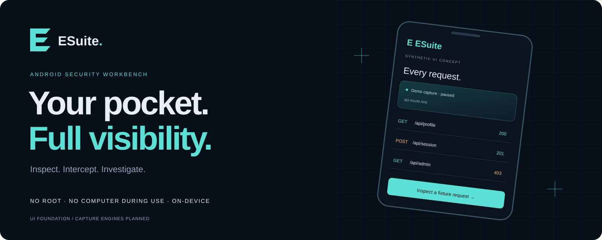
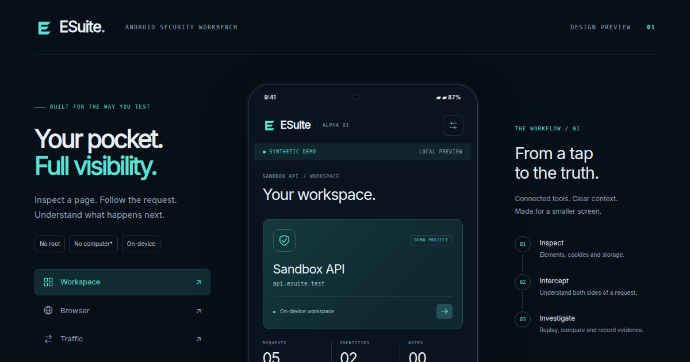
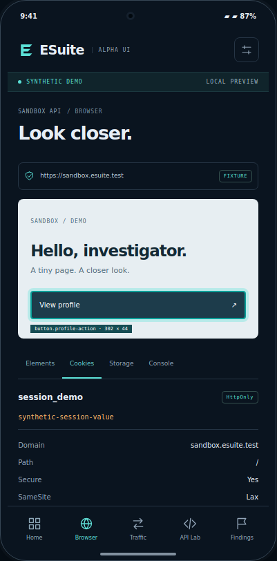
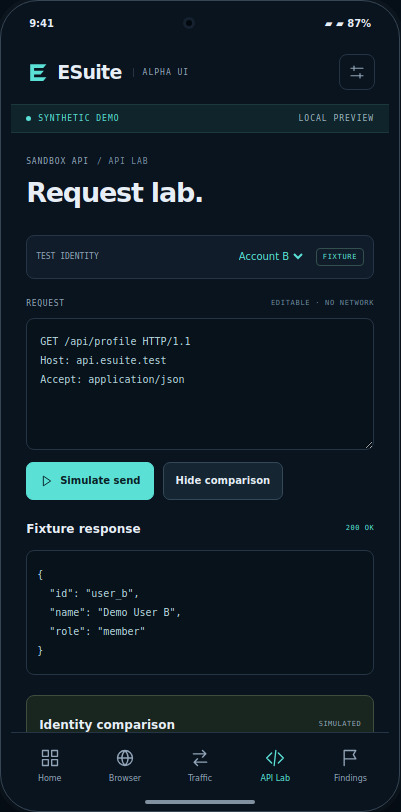

<p align="center"></p>

<h1 align="center">ESuite</h1>
<p align="center"><strong>Inspect. Intercept. Investigate.</strong><br>A security workbench being built for the Android device already in your pocket.</p>

<p align="center"><a href="#try-the-foundation">Get started</a> · <a href="docs/UI_SPEC.md">UI & design</a> · <a href="docs/ROADMAP.md">Roadmap</a> · <a href="docs/PRODUCT_PLAN.md">Full specification</a> · <a href="CONTRIBUTING.md">Contribute</a></p>



<p align="center"><strong>Native Android</strong> &nbsp; / &nbsp; <strong>No root required</strong> &nbsp; / &nbsp; <strong>No computer during use</strong> &nbsp; / &nbsp; <strong>Local processing</strong></p>

> **Development stage: UI foundation.** The repository contains a native Compose starter, working local transformation utilities, an interactive web design concept, and an implementation plan. **It does not yet intercept traffic, inspect live cookies, execute API requests, or scan targets.** The no-computer promise concerns the intended runtime; development still needs an Android build environment.

## A connected workflow, built for a phone

You are testing a web application from Android. A request behaves unexpectedly. You need the page, its cookies, the raw exchange, another test identity, and a place to record the evidence — without moving to a desktop.

ESuite's intended workflow connects those tasks:

**Open a target → inspect the page → follow the request → edit and replay → compare identities → preserve evidence.**

The product brings familiar proxy and API-testing workflows together with Android-friendly page inspection. Web and API testing come first. Cloud assessment follows through direct provider APIs and imported configurations, with analysis remaining on the phone.

## See the direction



<p align="center"><em>Responsive web interaction study, not an Android-device screenshot. Every request and identity shown is synthetic.</em></p>

| Browser inspection concept | Traffic investigation concept | API comparison concept |
| --- | --- | --- |
|  |  |  |

Explore the [self-contained UI concept](docs/ui/index.html), [editable Canva concept board](https://canva.link/pcvozypdf3nm0q0), and [UI specification](docs/UI_SPEC.md). Download the HTML file and open it locally to interact; GitHub's file view displays its source. The concept has no backend and makes no network requests after loading.

## What works today

| Component | Current behavior |
| --- | --- |
| Android app | Compose navigation across Home, Browser concept, Traffic fixtures, API concept and Tools |
| Native utilities | UTF-8 Base64 encode/decode, form URL encode/decode and SHA-256 hashing |
| Native request editor | Editable text and identity-specific fixture responses; no request execution |
| Web concept | Six views, searchable fixtures, request-detail transfer, simulated account comparison and in-memory notes |
| Web decoder | Real Unicode-aware Base64 transformations, executed locally |
| Design system | Original E monogram, vector banner, palette, navigation, flows and UI state specification |
| Engineering foundation | Gradle wrapper with pinned distribution checksum, unit tests, CI build definition and contribution guidance |

The current native manifest deliberately has **no INTERNET permission**. No VPN or capture service is registered. There is no credential vault or encrypted project database yet. Demo notes and state are not a durable evidence store.

## The toolkit we are building

These are planned capabilities. A feature's appearance in the concept is not evidence that its engine exists.

| Workspace | Planned capabilities |
| --- | --- |
| **Browser DevTools** | Touch element selection, DOM/CSS editing, console, native cookie metadata, storage explorer |
| **Proxy** | Scoped interception, request/response editing, forward/drop, match-and-replace and HTTP history |
| **API Lab / Repeater** | Request tabs, replay, response search, redirect controls, request chains and independent test identities |
| **Parameter runner** | Intruder-style insertion positions, wordlists, substitution modes, transformations, extraction and rate limits |
| **Target map** | Observed endpoints, parameters, scope, annotations, controlled discovery and API imports |
| **Scanner** | Passive traffic analysis first; selected active checks with reproducible evidence and explicit confidence later |
| **Sessions** | Cookie jars, expiry detection, login macros, token refresh and CSRF/nonces |
| **Comparer & Sequencer** | Structured response differences, identity matrices, token sampling and documented statistical tests |
| **WebSockets** | Supported message inspection, editing and replay |
| **Findings & Logger** | Tool provenance, original/edited exchanges, notes, redaction, local exports and retests |
| **Cloud** | Imported policy/configuration review and direct account audits; no remote analysis service |
| **Extensions** | Local rule packs, extractors, custom checks and a future bounded script interface |

Burp Suite is a workflow reference. ESuite is an independent Android project; it does not bundle Burp, claim scanner parity, or promise that desktop Burp extensions run unchanged.

## Designed around Android's actual boundaries

| Situation | Product commitment |
| --- | --- |
| Unrooted phone, no computer | Core runtime is designed to operate entirely on-device |
| Our testing browser | Native cookie inspection and explicitly configured interception are planned |
| Existing Chrome cookie store | No claim of direct access to another app's private cookie database |
| Other apps' traffic | Rootless selected-app capture through a planned local VPN engine |
| HTTPS from another app | Contents are inspectable only when trust, pinning and protocol behavior permit it |
| Unsupported or pinned traffic | Show observable metadata and the limitation; never imply successful decryption |
| Existing VPN | Android generally allows one active VPN service per user/profile; expose the conflict |
| Collaborator-style OAST | No hosted callback service under local-only requirements; reachable-lab phone listeners are a later limited option |

These are engineering requirements and known constraints, not currently implemented capture guarantees. The [product plan](docs/PRODUCT_PLAN.md) defines the feasibility and release gates.

## Your workspace should stay yours

The intended product has no mandatory account, analytics backend, hosted AI, automatic capture upload or remote worker. Target requests still travel to the target: local processing does not mean internet targets can be tested offline.

Planned storage protections include Keystore-protected keys, encrypted sensitive records, protected interception CA keys, retention limits, backup exclusions and explicit redacted exports. The current starter uses demonstration data and does not claim these future storage mechanisms are implemented.

## Try the foundation

### Android starter

Baseline: Android 9 / API 28 or newer; JDK 17 for development; Android SDK 35. Device coverage is not yet certified.

```bash
git clone https://github.com/modhack2003/Esuite.git
cd Esuite
./gradlew testDebugUnitTest lintDebug assembleDebug
```

Open the project in Android Studio, or use the command line with an installed SDK. On Windows use `gradlew.bat`. The debug APK is generated at `app/build/outputs/apk/debug/app-debug.apk`. The [build workflow](.github/workflows/ci.yml) uploads a debug APK when its Android job succeeds; this is a UI starter, not a pentesting release.

### Offline UI concept

```bash
cd design/prototype
npm ci
npm run typecheck
npm run build
```

Open `docs/ui/index.html` from the repository root. All scripts and styles are bundled into that file. Change screens, filter fixtures, transfer a request to API Lab, compare fixture identities, add a temporary note, or try the working Base64 decoder. No security testing takes place in this preview.

## Delivery path

| Milestone | Outcome |
| --- | --- |
| **Foundation — current** | Identity, reviewed interaction concept, native UI starter and local utilities |
| **M0 — feasibility** | Prove browser capture, cookies/profiles, VPN forwarding, CA trust and protocol coverage on physical devices |
| **M1 — manual workbench** | Live browser tools, Proxy, API execution, comparison, findings and local storage |
| **M2 — version 1** | Selected-app capture, bounded parameter runner, passive checks, resource controls and verified exports |
| **M3 — automation** | Macros, discovery, active checks, WebSockets, Sequencer and GraphQL workflows |
| **M4 — advanced / cloud** | Validated protocol tools, local extensions and cloud audits |

Track the [implementation checklist](docs/ROADMAP.md). Tests and device verification determine readiness; no release date or complete desktop-tool equivalence is promised.

## Inside the repository

| Path | Purpose |
| --- | --- |
| `app/` | Native Android Compose starter and codec unit tests |
| `design/prototype/` | React/TypeScript interaction concept and deterministic offline build |
| `design/EXTERNAL_DESIGNS.md` | Canva/MagicPath provenance and Superdesign connection status |
| `docs/assets/` | Brand SVGs and actual concept screenshots |
| `docs/ui/index.html` | Generated self-contained UI preview |
| `docs/PRODUCT_PLAN.md` | Complete feature plan and Android feasibility boundaries |
| `docs/UI_SPEC.md` | Tokens, navigation, state design and workflow definitions |
| `docs/ARCHITECTURE.md` | Current and proposed module/data boundaries |
| `docs/ROADMAP.md` | Honest completed/planned checklist |

Read [Contributing](CONTRIBUTING.md) before changing capture, authentication or data flows. Use the tool only for systems you own or have permission to test. For sensitive reports see [Security](SECURITY.md).

---

<p align="center"><strong>ESuite</strong> · Created by Bikram Dey · <a href="LICENSE">MIT License</a><br><sub>A clear view of the request. A smaller distance to the answer.</sub></p>
